

  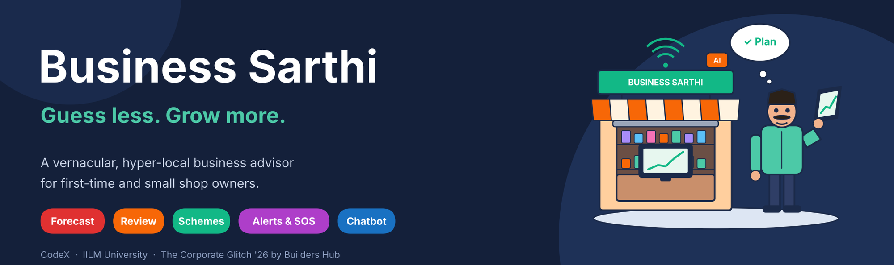

  
  
  
  

<h3 align="center">A vernacular, hyper-local business advisor for first-time and small shop owners.</h3>

  <b>Forecast before you invest. Review every 3 months. Grow, hold or pivot, in your own language.</b>

---

## Contents

- [The story](#-the-story)
- [The problem](#-the-problem)
- [Our solution](#-our-solution)
- [The hero feature: one living loop](#-the-hero-feature-one-living-loop)
- [How it works](#-how-it-works)
- [Before vs after](#-before-vs-after)
- [Tech stack and architecture](#-tech-stack-and-architecture)
- [How we compare](#-how-we-compare)
- [Business model](#-business-model-proposed)
- [Expected impact](#-expected-impact-a-target-to-test)
- [Roadmap](#-roadmap)
- [Research and references](#-research-and-references)
- [Team](#-team)

> **Project status.** Business Sarthi is currently at the **concept and design stage**. This repository holds the project documentation submitted to *The Corporate Glitch '26* (Builders Hub). Prototype code is not here yet. Everything below describes the product as designed, and anything not yet built is marked **planned**.

---

## 📖 The story

  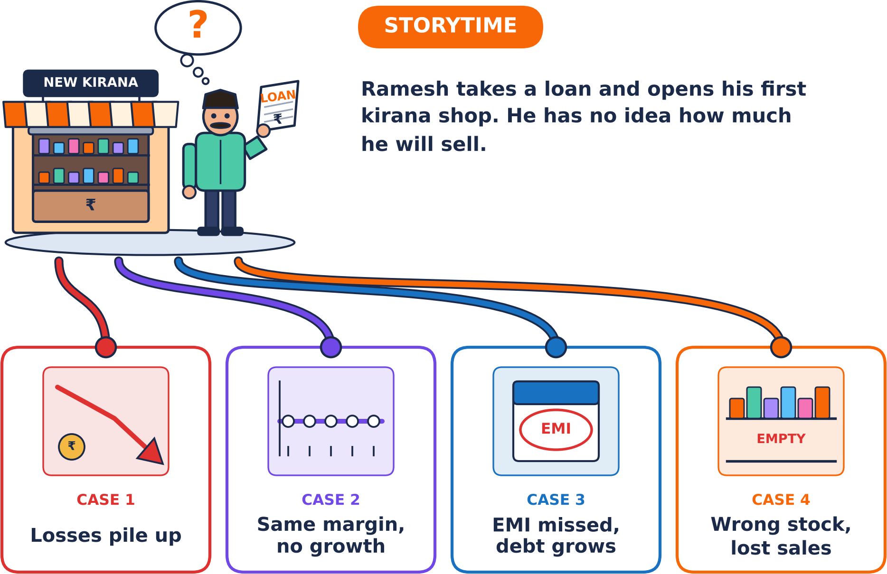

Ramesh takes a loan and opens his first kirana shop. He has no idea how much he will sell. From that one blind start, the roots branch out:

| Case | What happens |
|---|---|
| **1. Losses pile up** | Sales fall short of costs, and nobody warned him. |
| **2. Same margin, no growth** | The shop runs, but never moves forward. |
| **3. EMI missed, debt grows** | The repayment date arrives before the cash does. |
| **4. Wrong stock, lost sales** | One shelf overflows while another sits empty. |

---

## 🧭 The problem

Every business owner meets a chain of questions, from the first idea to daily operations. Existing tools solve one slice of it, such as ledgers, billing or scheme portals. None gives a first-time owner a forecast at set-up or a regular review after it.

  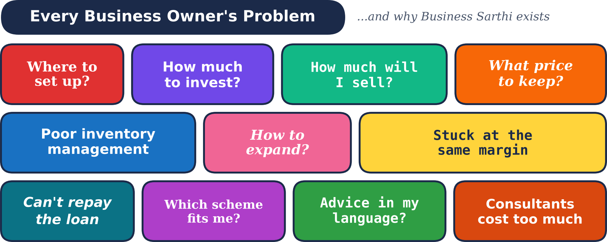

### Why it matters beyond one shop

  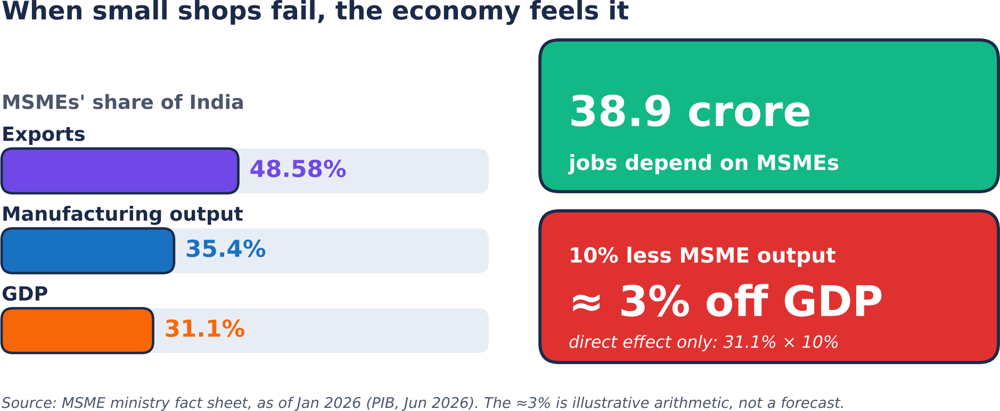

> Source: MSME ministry fact sheet, as of Jan 2026 ([PIB, Jun 2026](https://static.pib.gov.in/WriteReadData/specificdocs/documents/2026/jun/doc2026626903401.pdf)). The "about 3% off GDP" figure is simple illustrative arithmetic (31.1% × 10%), not a forecast.

---

## 💡 Our solution

**Business Sarthi** guides a shop owner from idea to growth on one platform, using the owner's own local data. It forecasts demand, revenue and break-even before set-up, then re-forecasts every 3 months from real sales and advises: **grow, hold or pivot**. Stock tracking, scheme matching, alerts, and a local-language chatbot support the owner throughout.

  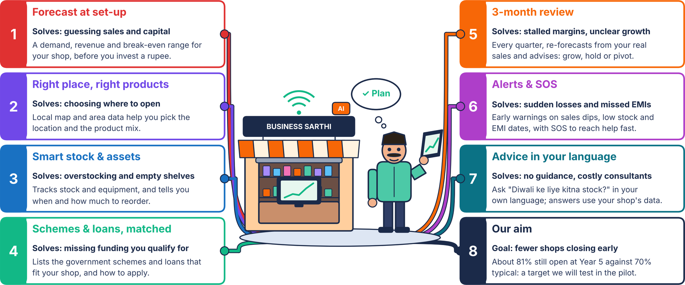

| # | Feature | Problem it solves |
|---|---|---|
| 1 | **Forecast at set-up** | Guessing sales and capital |
| 2 | **Right place, right products** | Choosing where to open |
| 3 | **Smart stock & assets** | Overstocking and empty shelves |
| 4 | **Schemes & loans, matched** | Missing funding you qualify for |
| 5 | **3-month review** | Stalled margins, unclear growth |
| 6 | **Alerts & SOS** | Sudden losses and missed EMIs |
| 7 | **Advice in your language** | No guidance, costly consultants |

---

## 🔁 The hero feature: one living loop

The core idea is a loop, not a one-time report. A competitor can copy any single feature. It is much harder to copy a forecast that gets sharper because every other feature feeds it.

  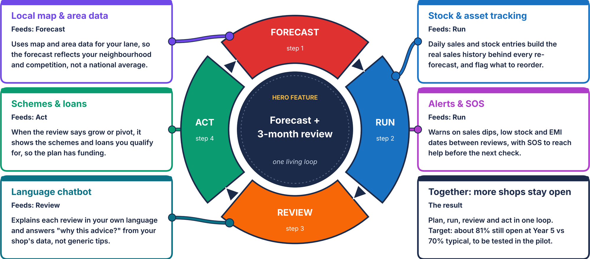

| Stage | What happens | Fed by |
|---|---|---|
| **1. Forecast** | A demand, revenue and break-even *range* before you invest | Local map and area data |
| **2. Run** | Daily sales and stock entries; early warnings | Stock & asset tracking, Alerts & SOS |
| **3. Review** | Every 3 months, a re-forecast from real sales | Language chatbot explains the "why" |
| **4. Act** | Grow, hold or pivot, with funding options | Schemes & loans matching |

---

## 🔧 How it works

### The owner's journey

<table>
<tr>
<td width="38%" valign="top">
  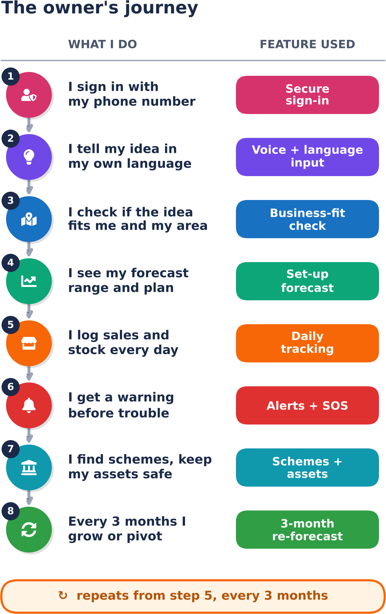
</td>
<td valign="top">

1. **Sign in** with a phone number.
2. **Tell the idea** in your own language, by voice or text.
3. **Business-fit check** for the idea and the area.
4. **See the forecast range** and a plan.
5. **Log sales and stock** every day.
6. **Get a warning** before trouble.
7. **Find schemes** and keep your assets safe.
8. **Every 3 months**, grow, hold or pivot, then repeat from step 5.

</td>
</tr>
</table>

### System architecture and process flow

  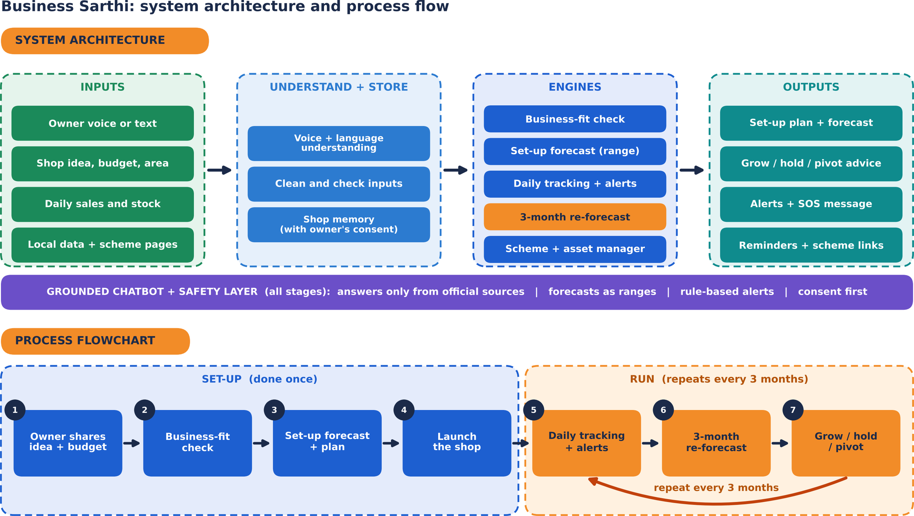

**Design principles**
- **Ranges, not promises.** Forecasts are shown as ranges and labelled as estimates.
- **Grounded answers.** The chatbot answers only from official sources and the owner's own data.
- **Rule-based alerts.** Alerts and SOS messages follow clear rules, not free-form model output.
- **Consent first.** The shop's data is used only with the owner's consent.

---

## 🧰 Tech stack and architecture

> The stack below is **planned** and may change as we build the prototype.

  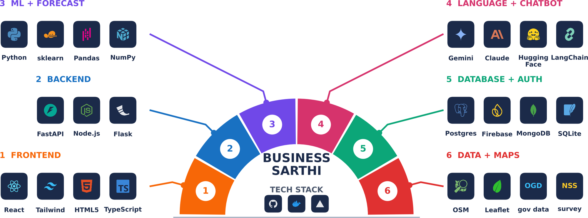

| Layer | Planned tools |
|---|---|
| **Frontend** | React, Tailwind, HTML5, TypeScript |
| **Backend** | FastAPI, Node.js, Flask |
| **ML + forecast** | Python, scikit-learn, Pandas, NumPy |
| **Language + chatbot** | A hosted, swappable LLM (Gemini, Claude), Hugging Face, LangChain |
| **Database + auth** | PostgreSQL, Firebase, MongoDB, SQLite |
| **Data + maps** | OpenStreetMap, Leaflet, data.gov.in, NSS survey data |
| **DevOps** | GitHub, Docker, Vercel |

### Request flow and model training

  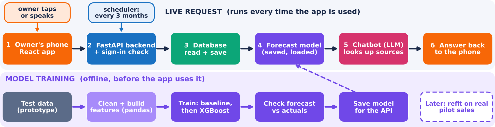

**Forecast approach (planned).** Start with a simple seasonal baseline, then move to gradient-boosted trees (e.g. XGBoost). The prototype will train on test data and refit on real pilot sales later. Each quarter we compare the forecast with actual sales and fix the model.

### Questions we expect

<table>
<tr>
<td width="38%" valign="top">
  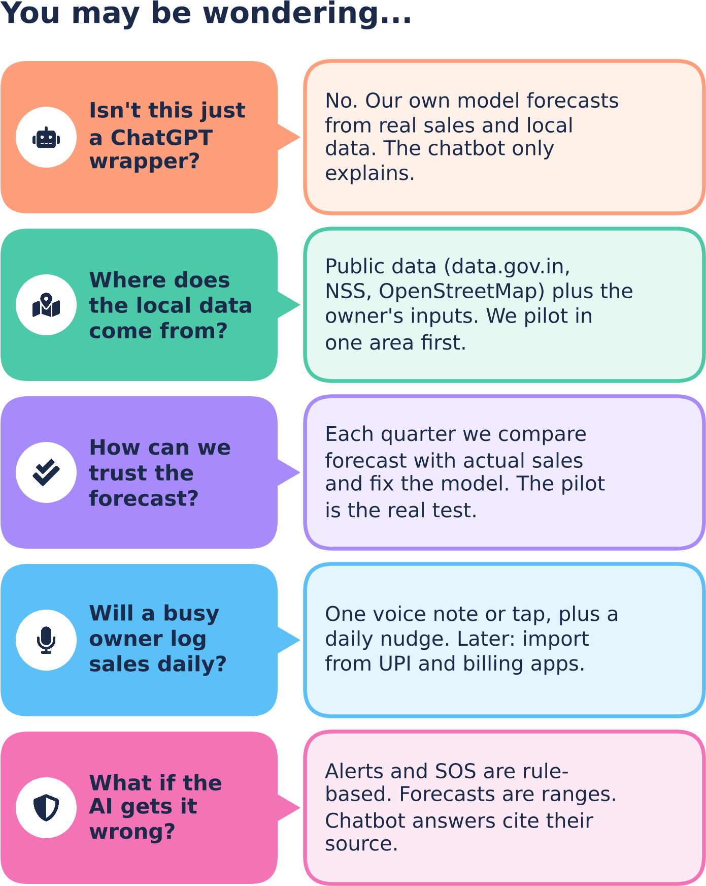
</td>
<td valign="top">

**Isn't this just a ChatGPT wrapper?**
No. Our own model forecasts from real sales and local data. The chatbot only explains.

**Where does the local data come from?**
Public data (data.gov.in, NSS, OpenStreetMap) plus the owner's inputs. We pilot in one area first.

**How can we trust the forecast?**
Each quarter we compare the forecast with actual sales and fix the model. The pilot is the real test.

**Will a busy owner log sales daily?**
One voice note or tap, plus a daily nudge. Later: import from UPI and billing apps.

**What if the AI gets it wrong?**
Alerts and SOS are rule-based. Forecasts are ranges. Chatbot answers cite their source.

</td>
</tr>
</table>

---

## 🆚 Before vs after

<table>
<tr>
<td width="42%" valign="top">
  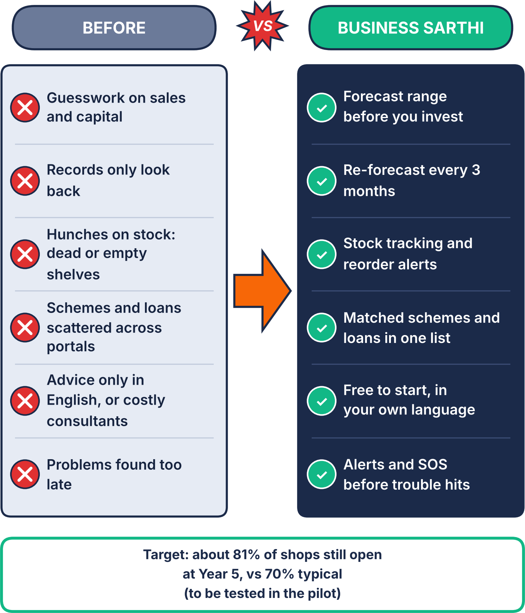
</td>
<td valign="top">

| Before | With Business Sarthi |
|---|---|
| Guesswork on sales and capital | Forecast range before you invest |
| Records only look back | Re-forecast every 3 months |
| Hunches on stock | Stock tracking and reorder alerts |
| Schemes scattered across portals | Matched schemes and loans in one list |
| Advice only in English, or costly consultants | Free to start, in your own language |
| Problems found too late | Alerts and SOS before trouble hits |

</td>
</tr>
</table>

---

## 🔍 How we compare

  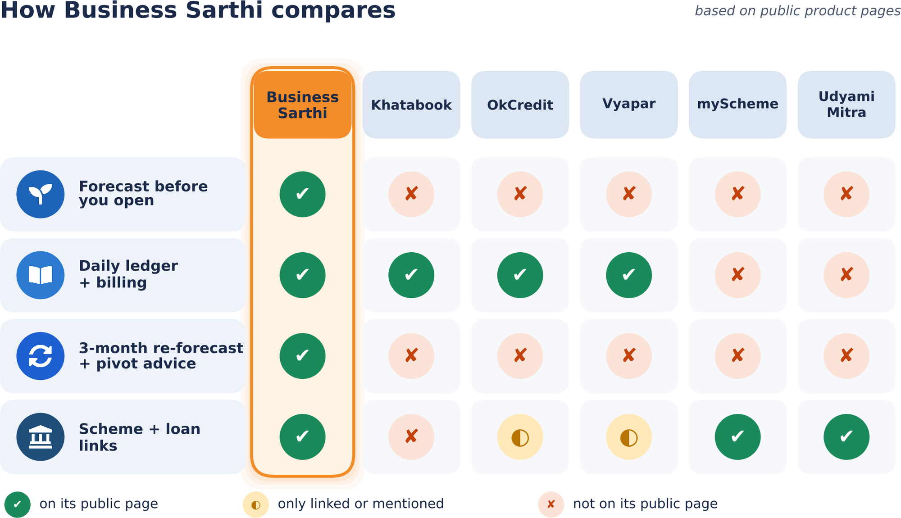

> Based on each product's public pages at the time of writing. ✔ = described on its public page, ◐ = only linked or mentioned, ✘ = not described on its public page. Products change, so please check their current pages.

---

## 💰 Business model (proposed)

<table>
<tr>
<td width="36%" valign="top">
  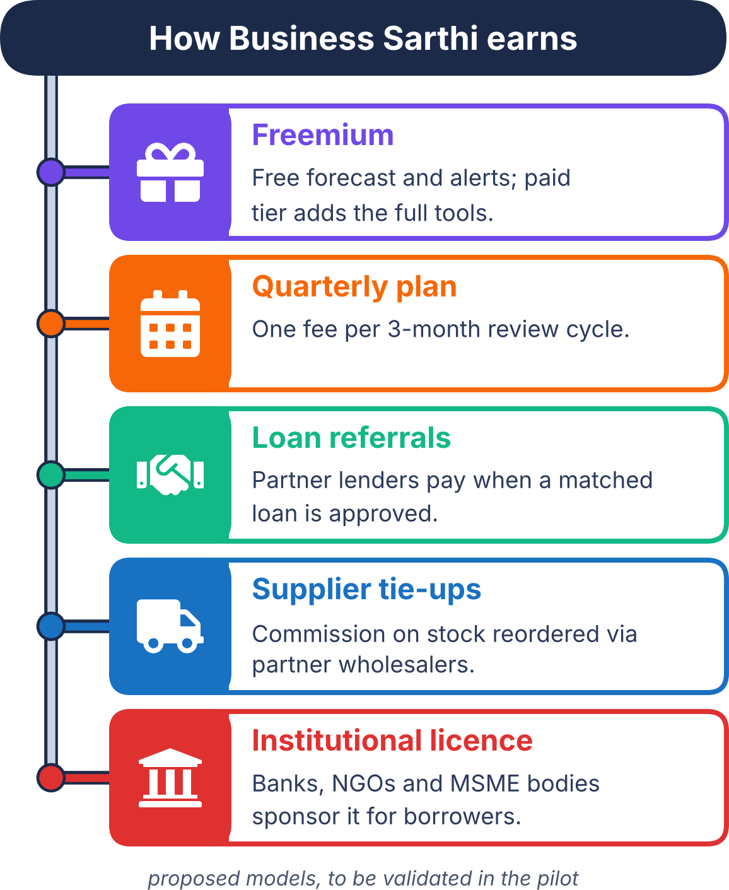
</td>
<td valign="top">

These are **proposed** models, to be validated in the pilot.

| Model | How it earns |
|---|---|
| **Freemium** | Free forecast and alerts; a paid tier adds the full tools |
| **Quarterly plan** | One fee per 3-month review cycle |
| **Loan referrals** | Partner lenders pay when a matched loan is approved |
| **Supplier tie-ups** | Commission on stock reordered via partner wholesalers |
| **Institutional licence** | Banks, NGOs and MSME bodies sponsor it for their borrowers |

</td>
</tr>
</table>

---

## 📈 Expected impact (a target to test)

  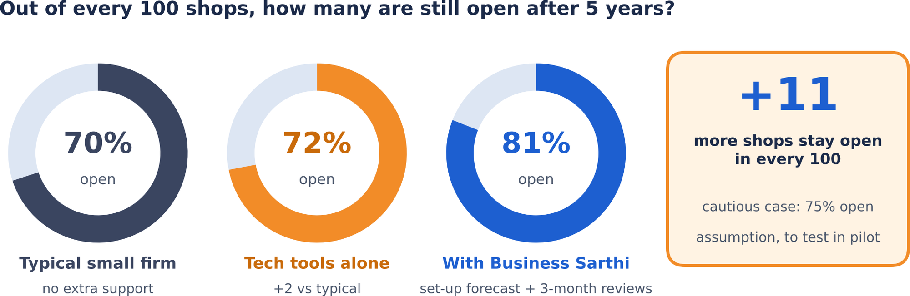

- **Baseline:** about 70% of Indian firms survive beyond five years (Policy Edge, 2026). The source does not specify firm size, so this may be generous for micro firms.
- **Our target:** about 81% still open at Year 5 (a cautious case of 75%), a gain of about 11 shops in every 100.
- **How it is modelled:** each line assumes the same yearly closure rate, reduced by a stated share. We assume 10% fewer closures for tech tools alone and 40% for Business Sarthi (cautious: 20%).
- **Important:** the 10% and 40% figures are **our assumptions, not measured results**. Validating them is the purpose of the pilot.
- **Why we expect a gain:** better business practices (marketing, stock, records, financial planning) predict higher survival and sales growth in small firms ([McKenzie & Woodruff, 2017](https://www.nber.org/papers/w21505)). One-off training gives modest, often short-lived gains, so we use a 3-month cycle to keep the effect going.

---

## 📍 Roadmap

- [x] **Phase 0: Concept and research.** Problem framing, solution design, architecture, competitor review, screening-round submission.
- [ ] **Phase 1: Prototype (planned).** Onboarding in the owner's language, a set-up form, and a first forecast range on test data.
- [ ] **Phase 2: The loop (planned).** Daily sales and stock logging, rule-based alerts, and the 3-month re-forecast with grow, hold or pivot advice.
- [ ] **Phase 3: Funding and support (planned).** Scheme and loan matching, plus the grounded vernacular chatbot.
- [ ] **Phase 4: Pilot (planned).** Test in one local area with real shop owners, refit the model on real sales, and measure whether the assumed gain holds.

---

## 📚 Research and references

| Research paper | Key finding / benefit for us | Link |
|---|---|---|
| Finance for MSMEs in India: Sources and Challenges (Singh & Wasdani, 2016) | Low awareness and collateral are the main barriers; 49 of 85 owners knew no scheme | [ADBI WP 581](https://www.adb.org/sites/default/files/publication/188868/adbi-wp581.pdf) |
| Awareness of Central Sector Schemes among MSME Entrepreneurs (Sajna & Dharmaraj, 2024) | Most of 396 surveyed owners had little or no scheme awareness | [IJISS 14(3)](https://ojs.trp.org.in/index.php/ijiss/article/view/4540) |
| Trends and Insights into Mudra Yojana Awareness (Salasty et al., 2025) | Owners learn about schemes mainly from friends and relatives; campaigns have gaps | [SIJASH 12(S1)](https://shanlaxjournals.in/journals/index.php/sijash/article/view/8978) |
| Using GIS for Retail Location Assessment (Murad, 2015) | Catchment and demand analysis judges shop locations (method support) | [IJACSA 6(7)](https://ftp.saiconference.com/Downloads/Volume6No7/Paper_18-Using_GIS_for_Retail_Location_Assessment_at_Jeddah_City.pdf) |
| Business Practices in Small Firms in Developing Countries (McKenzie & Woodruff, 2017) | Better business practices predict higher survival and sales growth | [NBER w21505](https://www.nber.org/papers/w21505) |
| MSME ministry fact sheet, as of Jan 2026 | MSME share of GDP, manufacturing, exports and jobs | [PIB, Jun 2026](https://static.pib.gov.in/WriteReadData/specificdocs/documents/2026/jun/doc2026626903401.pdf) |

**How research shapes the product**

| Research finding | What Business Sarthi does |
|---|---|
| Most surveyed owners knew no MSME scheme | Rules-based scheme matching |
| Poor market positioning is a key startup failure factor | Geospatial gap analysis for shop fit |
| Owners learn about schemes mostly from friends and relatives | Multilingual, grounded chatbot |

---

## 👥 Team

**Team CodeX**, IILM University

| Name |
|---|
| Tanu Naulakha |
| Richa Kumari |
| Alyssa Suri |
| Bappaditya Das |

Built for **The Corporate Glitch '26**, a national-level hackathon by **Builders Hub**.

---

  <i>Guess less. Grow more.</i> 
  Forecasts are estimates shown as ranges. Impact figures are targets to be tested in a pilot, not measured results.

