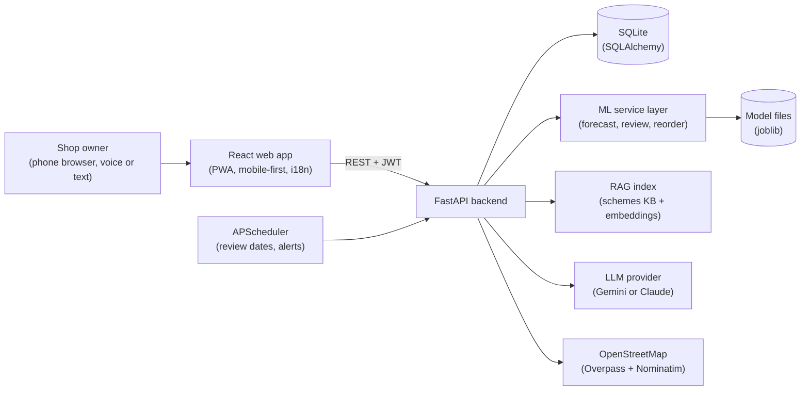
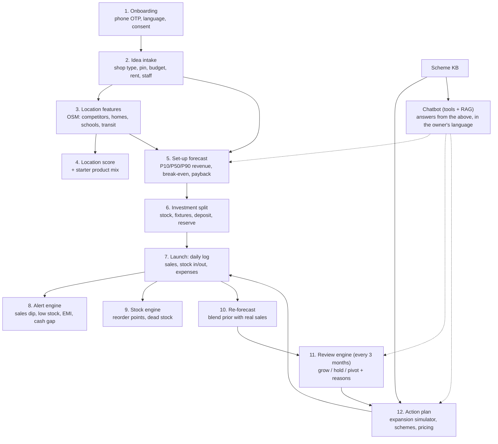
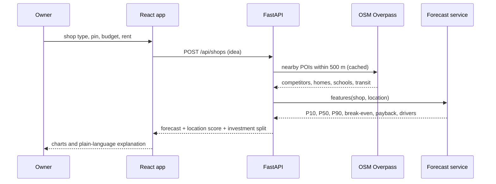
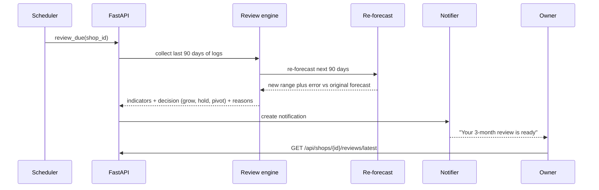
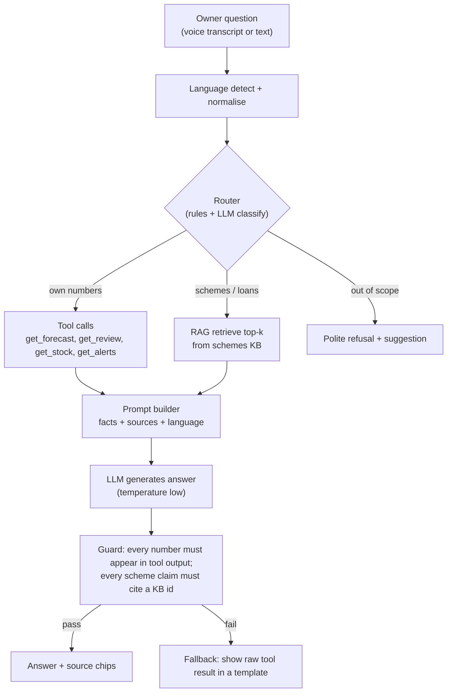
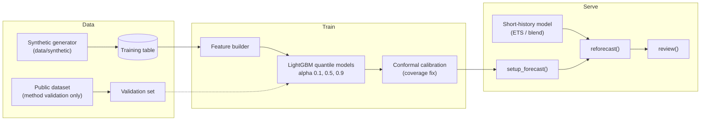
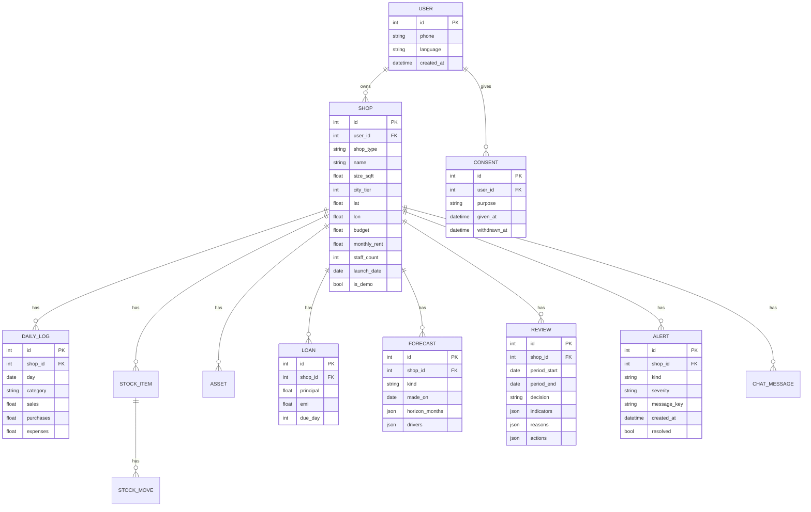

# ARCHITECTURE: how the system fits together

> Read `SPEC.md` first for the why. This file is the how: diagrams, data model, APIs, repo layout, demo script. All diagrams are Mermaid and render on GitHub.

## 1. System context



## 2. End-to-end pipeline (the hero loop as data flow)



Every number shown to the owner comes from boxes 3 to 12 (code). The chatbot reads their outputs through tools. It never invents them.

## 3. Sequence: set-up forecast



## 4. Sequence: 3-month review



## 5. Chatbot flow (grounded)



## 6. ML pipeline



## 5b. Component responsibilities

| Component | Responsibility | Must not |
|---|---|---|
| `frontend/` | UI, i18n, voice capture (Web Speech API), charts, offline queue for daily logs | Compute forecasts or decisions |
| `backend/app/api/` | HTTP routes, auth, validation | Hold business logic |
| `backend/app/services/` | Business logic orchestration | Call the LLM for decisions |
| `backend/app/ml/` | Forecast, review, reorder, location score, simulator | Touch HTTP or the database directly (takes DataFrames or dicts) |
| `backend/app/llm/` | `LLMClient` interface and providers, prompt templates, guard | Produce numbers |
| `backend/app/rag/` | KB loader, embeddings, retrieval | Store user data |
| `backend/app/jobs/` | Scheduled jobs | Run long tasks inline |
| `data/` | Synthetic generator, KB JSON, rules YAML | Contain real personal data |

## 7. Data model (SQLite via SQLAlchemy)



Other tables (columns kept minimal): `stock_item(shop_id, name, category, unit, cost, price, reorder_point)`, `stock_move(item_id, day, qty, kind)`, `asset(shop_id, name, cost, bought_on)`, `chat_message(shop_id, role, text, sources_json, created_at)`, `notification(user_id, kind, payload_json, read)`, `osm_cache(cell, radius_m, tags_version, counts, fetched_at)` (no personal data; M-01).

## 8. API list (v1)

| Method and path | Purpose | Checkpoint area |
|---|---|---|
| `POST /api/auth/otp/request`, `POST /api/auth/otp/verify` | Mock OTP login, returns JWT | B |
| `GET/PUT /api/me` | Profile and language | B |
| `GET/POST/DELETE /api/consents` | List, give or withdraw consent (`shop_data` required, `benchmarking` optional; DEC-43) | B |
| `POST /api/shops`, `GET /api/shops`, `GET /api/shops/{id}` | Create shop from idea; list and read own shops | B |
| `GET /api/shops/{id}/location-score` | Location score, nearby counts, starter mix | M |
| `POST /api/shops/{id}/forecast` | Set-up forecast and investment split | M |
| `POST /api/shops/{id}/logs` (bulk), `GET .../logs?from&to` | Daily sales, purchases, expenses | B |
| `GET/POST /api/shops/{id}/stock`, `POST .../stock/moves` | Stock items, movements | B |
| `GET /api/shops/{id}/stock/advice` | Reorder list and dead stock | M |
| `GET/POST /api/shops/{id}/assets` | Asset list | B |
| `GET/POST /api/shops/{id}/loans` | Loan and EMI | B |
| `GET /api/shops/{id}/alerts`, `POST .../alerts/{id}/resolve` | Alerts | B |
| `POST /api/shops/{id}/reviews/run` | Run review now (also scheduler) | M |
| `GET /api/shops/{id}/reviews/latest` and `/reviews` | Read reviews | M |
| `POST /api/shops/{id}/simulate` | Expansion simulator | M |
| `GET /api/schemes/match?shop_id=` | Matched schemes with sources | C |
| `POST /api/chat` | Chatbot (streams text) | C |
| `POST /api/sos` | Guided SOS summary | B |
| `POST /api/dev/advance-time` | Demo only, behind `DEV_MODE=1` | B |
| `DELETE /api/me/data` | Delete my data | B |

OpenAPI is generated by FastAPI at `/docs`. Keep it as the single contract; the frontend client can be generated from `openapi.json`.

## 9. Repo layout (target)

```text
Business-Sarthi/
  AGENTS.md
  README.md
  docs/                 SPEC, ARCHITECTURE, ML_PLAN, CHECKPOINTS, DECISIONS, CHANGELOG, MASTER
  tools/                build_master.py, status.py
  assets/               README images
  backend/
    app/
      main.py
      config.py
      db.py
      models/           SQLAlchemy models
      schemas/          Pydantic schemas
      api/              routers
      services/         business logic
      ml/               features.py, forecast.py, reforecast.py, review.py, reorder.py, location.py, simulate.py
      llm/              client.py, gemini.py, claude.py, prompts/, guard.py
      rag/              kb.py, embed.py, retrieve.py
      jobs/             scheduler.py, review_job.py, alert_job.py
    alembic/
    tests/
    data/               sarthi.db (git-ignored), models/ (git-ignored or small)
    pyproject.toml
  frontend/
    src/
      pages/            Onboarding, Idea, Forecast, Daily, Dashboard, Review, Schemes, Chat, SOS
      components/
      i18n/             en.json, hi.json
      api/
      voice/
    package.json
  data/
    synthetic/          generate.py, config.yaml
    kb/                 schemes.json (verified flags), sources.md
    rules/              review_rules.yaml, alert_rules.yaml, osm_tags.yaml, ...
    osm_mock/           hand-made mock OSM answers (OSM_MODE=mock)
  eval/                 forecast_eval.py, chat_eval.jsonl, chat_eval.py
  .env.example
  Makefile
```

## 10. Configuration (`.env.example`)

```text
DEV_MODE=1
DATABASE_URL=sqlite:///backend/data/sarthi.db
JWT_SECRET=change-me
LLM_PROVIDER=gemini        # gemini | claude | stub
LLM_API_KEY=
EMBED_MODEL=intfloat/multilingual-e5-small
OVERPASS_URL=https://overpass-api.de/api/interpreter
NOMINATIM_URL=https://nominatim.openstreetmap.org
OSM_MODE=mock
APP_USER_AGENT=BusinessSarthi/0.1 (contact: team email)
```

`LLM_PROVIDER=stub` returns templated text so the whole app and tests run with no API key.

## 11. Cross-cutting design

- **Languages:** i18n keys in `frontend/src/i18n/{en,hi}.json`; server returns message keys plus parameters for alerts and reviews, so the UI localises them. The chatbot answers in the language of the question (Hindi, English, Hinglish).
- **Voice:** browser Web Speech API for speech to text where supported, with text fallback. Text to speech optional (P2).
- **Offline tolerance:** daily entries are queued in `localStorage` and synced when online.
- **Time travel for demo:** `POST /api/dev/advance-time` shifts the "current date" used by jobs and runs due reviews, so a 3-month review can be shown in seconds.
- **Caching:** Overpass responses cached in SQLite for 30 days per rounded (lat, lon) cell (3 decimals, DEC-46). `OSM_MODE=mock` (default) uses labelled fixtures and no network (DEC-47); a failed live call falls back to labelled typical counts (DEC-45). Respect Overpass and Nominatim usage policies (identify with a User-Agent, at most about 1 request per second for Nominatim, no bulk geocoding).
- **Attribution:** show "Map data from OpenStreetMap contributors (ODbL)" wherever OSM-derived data or maps appear.
- **Privacy (DPDP Act 2023 aligned, not legal advice):** purpose-specific consent, data minimisation (phone number only, no Aadhaar or PAN), withdraw and delete endpoints, no real data in the prototype. Get a legal review before any real pilot.
- **Error handling:** every ML endpoint returns a `confidence` field (`low` when there are fewer than 30 days of data) and the UI shows it.
- **Logging:** structured logs; never log phone numbers in full (mask all but the last two digits).

## 12. Demo script (acceptance for the whole prototype)

Seed shop "Ramesh Kirana" with `python data/synthetic/generate.py --demo`:

1. Log in with mock OTP, pick Hindi, give consent.
2. Enter a kirana idea at a pin in a demo locality with budget 5 lakh and rent 15,000.
3. Show location score, starter mix, forecast range chart, break-even and payback range, investment split.
4. Jump into the pre-loaded 3 months of logs (one dip month and one EMI crunch seeded).
5. Show dashboard alerts (low stock, EMI due soon, sales dip).
6. Press "advance time", open the 3-month review and show the decision with reasons.
7. Ask the chatbot in Hindi: "Mujhe kaunsi scheme milegi?" and show cited sources, then "Is mahine ka profit kitna hai?" and show the tool-based answer.
8. Open the expansion simulator and show payback range.

## 13. Test strategy

| Layer | Tool | Target |
|---|---|---|
| Backend unit and API | pytest, httpx TestClient | Core services above 70% line coverage |
| ML | pytest + `eval/forecast_eval.py` | Metrics in `ML_PLAN.md` section 8 |
| Chatbot | `eval/chat_eval.py` on 30 questions | Grounded in at least 90% of answers |
| Frontend | Vitest + React Testing Library; Playwright for the demo path | Demo path passes headless |
| Lint and types | ruff, mypy (backend); eslint, tsc (frontend) | Zero errors |
| CI | GitHub Actions | Runs all of the above on pull requests |
