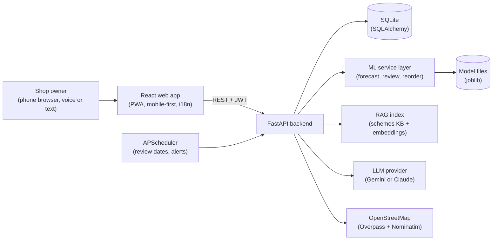
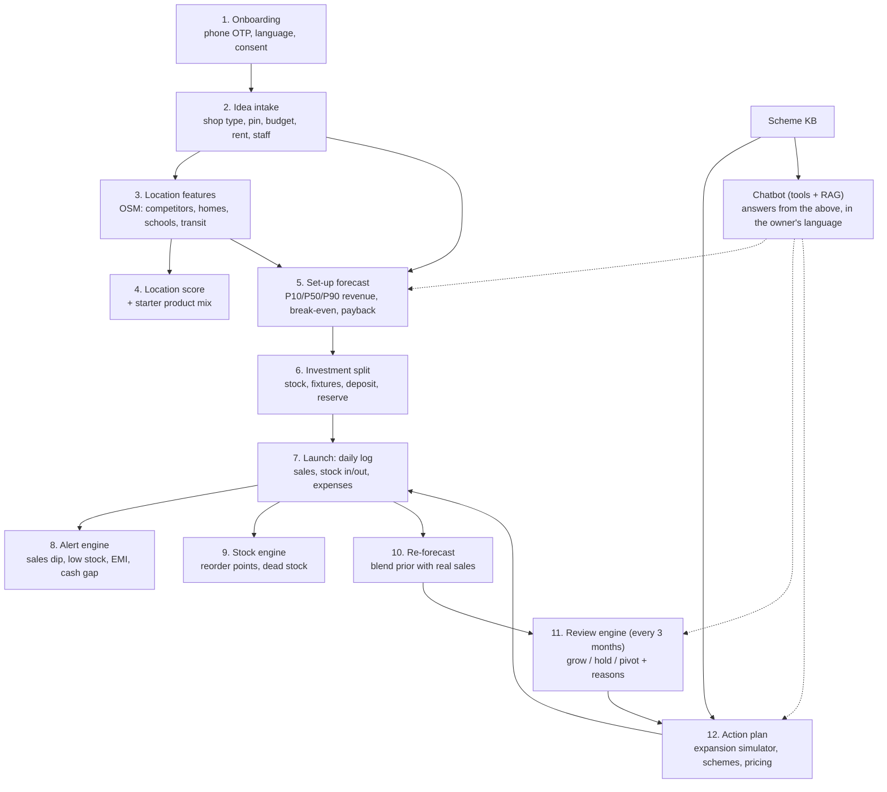
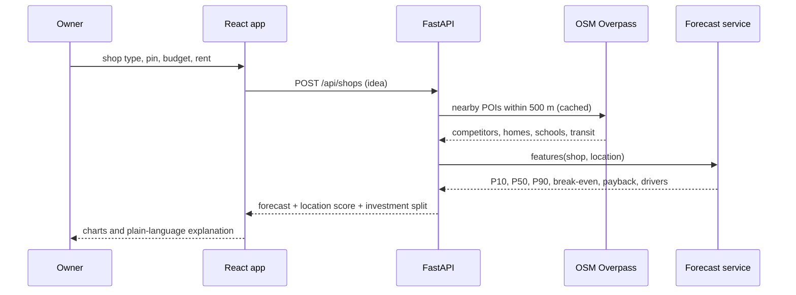
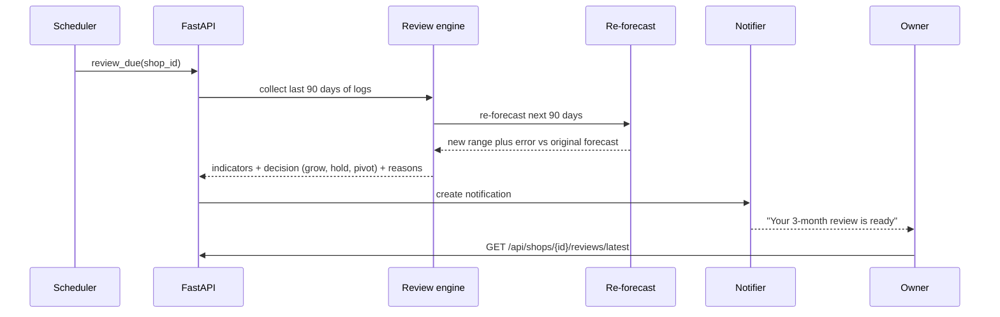
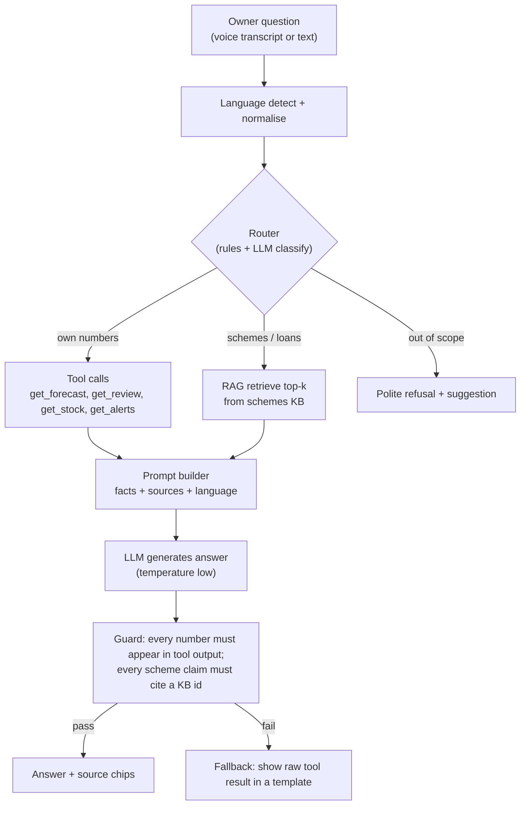
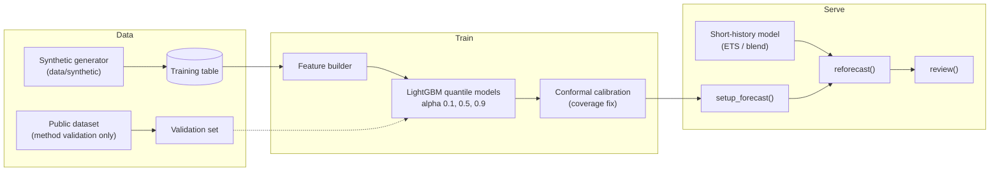
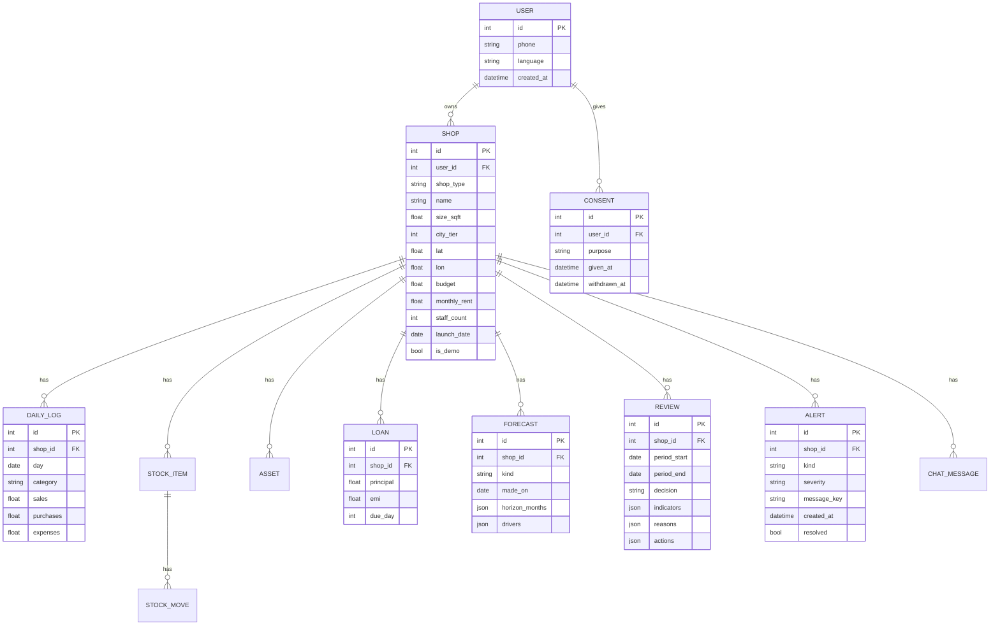

# Business Sarthi: MASTER (generated)
> Generated on 2026-11-17 by `tools/build_master.py`. **Do not edit by hand.** Edit the source files, then run `python tools/build_master.py`.
> Contents: `AGENTS.md`, `docs/CHECKPOINTS.md`, `docs/SPEC.md`, `docs/ARCHITECTURE.md`, `docs/ML_PLAN.md`, `docs/DECISIONS.md`, `docs/CHANGELOG.md`.


---

<!-- BEGIN AGENTS.md -->

# AGENTS.md: read this first

You are a coding assistant joining the **Business Sarthi** project. You have no memory of earlier work. This file tells you how to get oriented in under 5 minutes, what the rules are, and how to record your progress so the next session (human or model) can continue without any extra context.

## 1. What this project is, in 5 lines

- **Business Sarthi** is a vernacular, hyper-local business advisor for first-time and small shop owners in India (first persona: a kirana/grocery owner).
- **Hero idea:** a forecast *before* the owner invests, then a re-forecast and a **grow / hold / pivot** review **every 3 months** from the owner's real sales.
- **Supporting modules:** location and product-mix guidance, stock and asset tracking, scheme and loan matching, alerts and SOS, and a grounded chatbot that answers in the owner's language.
- **Origin:** built for *The Corporate Glitch '26* (Builders Hub) by Team CodeX, IILM University. Repository: `github.com/bappadityadas272-beep/Business-Sarthi`.
- **Honest status:** at the time of writing this is a **concept with documentation only**; no application code exists yet. Always read `docs/CHECKPOINTS.md` for the real status.

## 2. Read order (do this before writing any code)

1. `docs/CHECKPOINTS.md`: the status tracker. Read the `project_status` block at the top, then find the checkpoint you will work on.
2. `docs/SPEC.md`: what we build and why each feature exists.
3. `docs/ARCHITECTURE.md`: system design, pipeline diagrams, data model, API list, repo layout.
4. `docs/ML_PLAN.md`: models, data, evaluation. Read this before touching anything in `backend/app/ml/`.
5. `docs/DECISIONS.md`: choices already made. **Do not re-open a decision without logging a new one.**
6. `docs/CHANGELOG.md`: what changed and when.

`docs/MASTER.md` is all of the above merged into a single file (generated). If you can only read one file, read that. **Never edit `MASTER.md` by hand**: it is regenerated by `python tools/build_master.py`.

## 3. Locked decisions (summary; full list in `docs/DECISIONS.md`)

| Layer | Choice |
|---|---|
| Frontend | React + TypeScript + Vite + Tailwind CSS, `react-i18next`, Leaflet for maps |
| Backend | Python 3.11+, FastAPI, Pydantic v2, SQLAlchemy 2 + Alembic |
| Database | SQLite for the prototype (file `backend/data/sarthi.db`); keep SQL portable so PostgreSQL works later |
| ML | pandas, NumPy, scikit-learn, statsmodels, LightGBM (Huber P50 + conformal ratio band, DEC-35), joblib for model files |
| LLM | Hosted API behind a `LLMClient` interface (Gemini or Claude, chosen by env var). The LLM **explains**; it never produces forecast numbers or decisions |
| RAG | Multilingual sentence embeddings (`intfloat/multilingual-e5-small`) + FAISS (or NumPy cosine) over the scheme knowledge base |
| Scheduling | APScheduler in-process, plus a dev "advance time" endpoint for demos |
| Auth | Phone OTP. Prototype uses a **mock OTP**; production would use an SMS provider |
| Data | Synthetic shop data (clearly labelled) + one public dataset used only to validate the forecasting method |

## 4. Non-negotiable rules

1. **Honesty about data.** Forecasts are **ranges (P10 / P50 / P90)**, labelled as estimates. Any figure that is an assumption (for example the 81% survival target) must be labelled as a target or assumption in the UI and the docs.
2. **The LLM never decides.** Forecasts, break-even, review decisions and alerts come from code. The LLM only explains them in the owner's language and answers questions with tool results and cited sources.
3. **Cite or say "I don't know".** Scheme and loan facts must come from `data/kb/schemes.json` and carry a source URL and `last_verified` date. If the knowledge base has no answer, the chatbot says so.
4. **Synthetic data is labelled.** Any dataset produced by `data/synthetic/` must carry `is_synthetic=true` in its metadata and in any report that uses it.
5. **Consent first.** No shop data is stored or used before the owner's consent record exists (see `docs/ARCHITECTURE.md`, data model, `consents`).
6. **No secrets in git.** API keys live in `.env` (copy from `.env.example`). Never commit `.env`.
7. **Small, testable steps.** One checkpoint per branch or commit group. Every checkpoint has an "acceptance" line: do not mark it done until that test passes.
8. **Prototype means prototype.** No claims of production readiness, medical/legal/financial advice, or guaranteed outcomes anywhere in the UI or docs. Scheme guidance carries a "check the official page" notice.

## 5. How to work on a checkpoint

1. Pick the first `TODO` checkpoint in `docs/CHECKPOINTS.md` whose `Depends` are all `DONE`, in priority order (P0, then P1, then P2) unless the human names one.
2. Change its status to `IN_PROGRESS` and set `current_focus` in the `project_status` block.
3. Build it, following the file paths in `docs/ARCHITECTURE.md` section "Repo layout".
4. Run the acceptance test written on the checkpoint's row. Also run `make test` (once it exists) and the linters.
5. Update the row to `DONE` (or `BLOCKED` with a reason in the Notes column).
6. Add an entry at the top of `docs/CHANGELOG.md` (date, checkpoint IDs, what changed, anything the next person must know).
7. If you made or changed a decision, add it to `docs/DECISIONS.md` with a new ID. Never silently change a locked decision.
8. Run `python tools/build_master.py` to refresh `docs/MASTER.md`, and `python tools/status.py` to print a progress summary.
9. Commit using the format: `CP-<ID>: <short summary>` (for example `B-03: add mock OTP login`).

## 6. Status vocabulary

`TODO` (not started) · `IN_PROGRESS` · `DONE` (acceptance passed) · `BLOCKED` (see Notes) · `DROPPED` (decided not to do; reason in `DECISIONS.md`).

Priority: **P0** = on the demo path, build first · **P1** = important, build after the demo path works · **P2** = nice to have.

## 7. When you are unsure

- Prefer the simplest thing that satisfies the acceptance line.
- If a requirement is ambiguous, check `docs/SPEC.md` first, then `docs/DECISIONS.md`. If still unclear, ask the human a specific multiple-choice question rather than guessing, and record the answer in `docs/DECISIONS.md`.
- If you cannot verify a fact (a scheme rule, a licence, a dataset), mark it `verified: false` in the data and add a `TODO` note instead of inventing details.

## 8. Starter prompt for a new chat session

Paste this at the start of a fresh chat with a coding model, together with `docs/MASTER.md` (or the files listed in section 2):

```text
You are joining the Business Sarthi project. Read AGENTS.md and docs/MASTER.md fully before doing anything.
1. Summarise the current project status from the project_status block in CHECKPOINTS.md.
2. List the next 3 checkpoints that are TODO with all dependencies DONE.
3. Ask me which one to start, or start the first one if I say "go".
Follow the rules in AGENTS.md. When you finish a checkpoint, update CHECKPOINTS.md and CHANGELOG.md, and show me the exact diffs.
```

<!-- END AGENTS.md -->


---

<!-- BEGIN docs/CHECKPOINTS.md -->

# CHECKPOINTS: the live status tracker

> **This is the file that tells any new session where the project stands.** Update it whenever a checkpoint changes. `python tools/status.py` reads it and prints a summary.

```yaml
project_status:
  phase: "1 - backend core done (hero loop + grounded chatbot API: C-01, C-04 to C-07); frontend not started"
  last_updated: "2026-11-17"
  current_focus: "next: frontend skeleton S-03, then F-01..F-04 (or D-03 + C-02 + C-03 for the scheme half of demo step 7)"
  blockers:
    - "C-08: needs the 30 questions in eval/chat_eval.jsonl (written by the team, DEC-80) and a live LLM key"
    - "Live provider check of C-07 not run: no .env with LLM_PROVIDER and LLM_API_KEY yet"
  demo_path_ready: false
  notes: "Backend works end to end on synthetic demo data (make synth, make train, make seed, advance time); POST /api/chat answers demo step 7 'Is mahine ka profit kitna hai?' in Hinglish, Hindi and English with the stub, guard first, then SSE (DEC-73, DEC-79). Missed targets: scheme half of step 7 is a template until D-03, C-02, C-03 (DEC-74); live Gemini check (make chat-live) not run; tests run only in Docker (Smart App Control blocks host DLLs). Live Overpass answer format is unverified. app_help.yaml is a draft until the frontend exists (DEC-78)."
```

**Status values:** `TODO` · `IN_PROGRESS` · `DONE` · `BLOCKED` · `DROPPED`
**Priority:** P0 demo path · P1 important · P2 nice to have
**Build order (vertical slices):** S (setup) → B-01..B-05 + D-01 + M-01..M-05 (first working forecast) → F-01..F-04 (first visible slice) → daily logs, stock, alerts → review loop → chatbot and schemes → polish and release.

Column key: **Feat** = feature from `SPEC.md`; **Depends** = checkpoint IDs that must be `DONE` first; **Acceptance** = the test that must pass before marking `DONE`.

## S: Setup

| ID | Title | Feat | Pri | Depends | Status | Acceptance | Notes |
|---|---|---|---|---|---|---|---|
| S-01 | Repo scaffold: folders from ARCHITECTURE section 9, `.gitignore` (db, `.env`, models, node_modules), MIT `LICENSE`, `.env.example` | all | P0 | - | DONE | Tree matches layout; `git status` clean of secrets | LICENSE deferred pending team approval (DEC-17); AGENTS.md moved back to root (DEC-16) |
| S-02 | Backend skeleton: FastAPI app, config loader, `/api/health`, pyproject with pinned deps | all | P0 | S-01 | DONE | `pytest` passes a health test; `uvicorn` serves `/docs` | Runs in Docker (DEC-20): `docker compose run --rm backend pytest` |
| S-03 | Frontend skeleton: Vite + React + TS + Tailwind, router, empty pages | all | P0 | S-01 | TODO | `npm run build` succeeds; home page renders | |
| S-04 | Makefile (`setup`, `dev`, `test`, `lint`, `train`, `seed`) | all | P1 | S-02, S-03 | TODO | `make test` runs both test suites | |
| S-05 | GitHub Actions CI (lint, type check, tests) | all | P1 | S-04 | TODO | CI green on a pull request | |

## D: Data and knowledge

| ID | Title | Feat | Pri | Depends | Status | Acceptance | Notes |
|---|---|---|---|---|---|---|---|
| D-01 | Synthetic data generator per ML_PLAN section 2 (config.yaml, seed, `--demo`) | F1 | P0 | S-01 | DONE | Generates 1,000 shops x 24 months (DEC-39; was 200); two runs with same seed are identical; every file has `is_synthetic` metadata | v1.1 after human review: floor 2,000 (0.5% of shops at it), per-shop +/-10% effect strength, festival uplift per category, 2 demo shops; 11 tests in tests/test_synthetic.py; DEC-23 to DEC-30 |
| D-02 | Pick and **licence-check** one public retail dataset; document in `data/PUBLIC_DATA.md` (name, URL, licence, date checked) | F1 | P1 | S-01 | TODO | Licence permits our use, or dataset replaced | Do not commit the raw data if the licence forbids |
| D-03 | Scheme KB v0: 5 to 8 entries from official pages, `verified:false`, with source URL and `last_verified` | F4 | P1 | S-01 | TODO | JSON validates against schema; every entry has a source URL | Human verification is R-04 |
| D-04 | Rule files: `review_rules.yaml`, `alert_rules.yaml`, `location_weights.yaml`, `product_mix.yaml`, `blend.yaml`, `actions.yaml`, `expansion.yaml` | F1,F2,F5,F6,F8 | P0 | S-01 | DONE | Loader validates every file with Pydantic | Loader `app/rules.py`; 8th file `investment_split.yaml` added (DEC-22); drafted values approved as assumptions (DEC-21) |
| D-05 | Demo seed: Ramesh Kirana with 3 months of logs, a dip month and an EMI squeeze | all | P0 | D-01, B-01 | DONE | `make seed` creates the demo user and shop; demo script step 4 works | make seed loads Ramesh Kirana (review: pivot) and Sunita General Store (review: grow), dates shifted to the seed day (DEC-70); 6 tests. Dip deepened to 50% so the sales-dip alert shows (DEC-72). DEC-71 details await confirmation |

## B: Backend

| ID | Title | Feat | Pri | Depends | Status | Acceptance | Notes |
|---|---|---|---|---|---|---|---|
| B-01 | SQLAlchemy models and Alembic migration for ARCHITECTURE section 7 | all | P0 | S-02 | DONE | `alembic upgrade head` creates all tables; model tests pass | 13 tables; migration 0001; FK pragma on; unique (shop, day, category) on daily_log for B-05 |
| B-02 | Mock OTP auth + JWT | all | P0 | B-01 | DONE | Request and verify OTP returns JWT; wrong OTP is rejected; protected route needs token | OTP printed to server log in DEV_MODE and returned as dev_otp (DEC-40); JWT 7 days (DEC-41) |
| B-03 | Profile, language, consent endpoints | all | P0 | B-02 | DONE | Shop creation refused (403) without consent record | Purposes shop_data (required) and benchmarking (optional), DEC-43 |
| B-04 | Shops create and read | F1 | P0 | B-03 | DONE | Owner can create and read only own shops | Adds name, size_sqft, city_tier (DEC-42); other owners get 404 |
| B-05 | Daily logs bulk create and range read | F3,F5 | P0 | B-04 | DONE | Duplicate (shop, day, category) updates not duplicates; range query correct | Upsert on (shop, day, category); range read with daily totals; missing days stay missing |
| B-06 | Stock items, moves and assets | F3 | P0 | B-04 | DONE | On-hand stock equals sum of moves | On-hand = sum of moves (never stored); bulk moves all-or-nothing; input defaults in DEC-54 await confirmation |
| B-07 | Loans and EMI schedule | F6 | P0 | B-04 | DONE | Next due date computed correctly across month ends | start_date + tenure_months (DEC-53, migration 0004); schedule is dates and EMI only |
| B-08 | Alerts store, resolve, notifications | F6 | P0 | B-04 | DONE | Alert create, list, resolve works; notifications unread count | Alert create, list, resolve (with mute) and notifications unread count work; 6 tests. Refresh is on request until B-09 adds the daily job. DEC-68 details await confirmation |
| B-09 | APScheduler jobs and `POST /api/dev/advance-time` | F5,F6 | P0 | B-05, M-08, M-09 | DONE | Advancing 90 days triggers a review and stores it | Only when `DEV_MODE=1`. Advancing 90 days stores a review and a review_ready notification; 6 tests. Demo clock is in memory (resets on restart). DEC-69 details await confirmation |
| B-10 | SOS summary endpoint | F6 | P1 | B-08 | TODO | Returns a shareable summary of alerts and EMI status | |
| B-11 | Delete-my-data endpoint | all | P1 | B-04 | TODO | After delete, no rows remain for the user | |

## M: Machine learning and engines

| ID | Title | Feat | Pri | Depends | Status | Acceptance | Notes |
|---|---|---|---|---|---|---|---|
| M-01 | OSM client (Overpass + Nominatim), cache table, feature extractor | F2 | P0 | B-04 | DONE | Given a pin, returns counts of competitors, homes, schools, transit; second call hits cache; User-Agent set | Mock responses in tests; live Overpass format NOT verified (server busy 2026-11-16), see CHANGELOG |
| M-02 | Location score (ML1) + starter product mix | F2 | P1 | M-01, D-04 | TODO | Score and top drivers returned; scenario tests pass | |
| M-03 | Train ML2 quantile models | F1 | P0 | D-01 | DONE | Model files and `model_card.json` written; `make train` reproducible | make train in Docker; LightGBM Huber P50 + ratio band (DEC-31 to DEC-36); reproducible SHA-256 |
| M-04 | Conformal calibration + evaluation report | F1 | P0 | M-03 | DONE | `eval/forecast_eval.py` prints WAPE vs baseline, pinball loss, coverage; coverage within 75% to 85% | SYNTHETIC, 200 test shops: WAPE 0.197 vs peer median 0.313 (37% lower); coverage 80.5%; 0 monotone breaks. First run on 200 shops missed coverage (94.0%), data grown to 1,000 shops (DEC-39); see EVAL_REPORT. Public-data run waits for D-02 |
| M-05 | Forecast service + endpoint + investment split | F1,F8 | P0 | M-04, M-01, B-04, D-04 | DONE | `POST /forecast` returns P10/P50/P90 for 12 months, break-even, payback range, drivers, confidence | Endpoint + service; margin, wage and payback extension are labelled assumptions (DEC-48 to DEC-52); confidence low under mock OSM by design |
| M-06 | Re-forecast (ML3) | F5 | P0 | M-05, B-05 | DONE | Backtest shows blend beats prior-only after 2 months; handles gaps | Met on synthetic shops: blend WAPE 8.8% vs prior-only 19.5% at 2 months (k = 10, DEC-55). Honest notes in EVAL_REPORT |
| M-07 | Stock advice (ML4) | F3 | P0 | B-06 | DONE | ROP, reorder qty, dead and overstock flags match hand-calculated cases | Hand-calculated cases pass (17 tests). Simulation on synthetic shops: 4.05 vs 9.57 stock-out days per 30 at 0.95x stock, met only after DEC-59 (first version 1.44x, missed) |
| M-08 | Review engine (ML5) + endpoint | F5 | P0 | M-06, M-07, B-07, D-04 | DONE | 20 labelled scenarios all give the expected decision | All 20 hand-labelled scenarios give the expected decision; no threshold changed. 30 tests. Thresholds are untested assumptions; DEC-66 details await confirmation |
| M-09 | Alert engine (ML6) | F6 | P0 | B-05, B-07, M-07, D-04 | DONE | Injected dips detected (recall at least 90%); false alarms under 1 per shop per month | Synthetic test shops: recall 95.3% on dips of 35% or deeper within 14 days, 0 false alarms (clean generator; see EVAL_REPORT notes). 17 tests. Not yet wired to the API (B-08, B-09) |
| M-10 | Expansion simulator (ML9) | F8 | P2 | M-06 | TODO | Returns payback range and P(payback<12m) for 3 options | Assumptions flagged in output |
| M-11 | Pricing helper (ML10) | F9 | P2 | B-06 | TODO | Flags categories below target margin | |

## C: Chatbot and schemes

| ID | Title | Feat | Pri | Depends | Status | Acceptance | Notes |
|---|---|---|---|---|---|---|---|
| C-01 | `LLMClient` interface + providers (gemini, claude, stub) | F7 | P0 | S-02 | DONE | Stub returns deterministic text; provider chosen by env var | `app/llm/client.py`, `stub.py`, `gemini.py`, `claude.py` over httpx; retry 1/2/4 s with jitter, 20 s timeout, fallback, daily answer cache (DEC-75); 11 tests, network mocked. Live providers not yet run |
| C-02 | KB loader + embedding index build | F4,F7 | P1 | D-03 | TODO | `python -m app.rag.build_index` writes index; top-1 retrieval correct on 10 test queries (Hindi and English) | |
| C-03 | Scheme matcher (ML7) + endpoint | F4 | P1 | C-02, B-04 | TODO | 20 profile tests; top-3 contains expected scheme in at least 80% | |
| C-04 | Chat tools (`get_forecast`, `get_latest_review`, ...) | F7 | P0 | M-05, M-08, M-07, M-09 | DONE | Each tool returns structured JSON for the demo shop | `app/llm/tools.py`: six tools; each output has `source` {id,label}, `as_of`, `note` and flat `facts` {key,value,unit,period}; profit periods and EMI shown apart per DEC-77; `match_schemes` returns `[]` with `no_verified_source` (DEC-74); `run()` checks owner and consent (one `shop_not_found` error); 8 tests on both demo shops |
| C-05 | Router + prompt builder + language handling | F7 | P0 | C-01, C-04 | DONE | Intent routing correct on 20 sample questions; reply language matches | `app/llm/router.py` (rules first, `<classify>` LLM fallback limited to the 5 labels), `language.py` (hi / hinglish / en), `prompts/system.md`, `prompts/classify.md`, builder in `prompts/__init__.py`, `templates.py` (3 languages, Indian ₹ grouping), `app_help.yaml` (draft); 46 tests: 20 routes, 10 languages, 7 refusals (DEC-78 proposed) |
| C-06 | Guard (number and citation check) + fallback template | F7 | P0 | C-05 | DONE | Injected wrong number is caught and replaced by the template | `app/llm/guard.py` (DEC-76); `tests/test_guard.py` 19 tests: wrong number, swapped ₹/lakh, Devanagari, other-month number, invented scheme, tool-output injection, "ignore your rules", guarantee/link/script; forced bad stub answer gives the template; every demo template answer passes. Question numbers count as plain only |
| C-07 | `POST /api/chat` with streaming | F7 | P0 | C-06, C-03, B-03 | DONE | Demo script step 7 works with stub and with a real provider | Built before C-03 (DEC-74). `app/services/chat.py` + `app/api/chat.py`: SSE meta/delta/done after the guard (DEC-73, DEC-79); both turns stored with sources; login + consent + own shop. `tests/test_chat_api.py`: profit question in Hinglish, Hindi and English passes the guard with the code's number. **Missed:** scheme half of step 7 (template only, until D-03, C-02, C-03); live check run 2026-11-17 (`make chat-live`): the old default model was retired (404); with DEC-81 all 6 LLM answers in Hinglish, Hindi and English passed the guard, all via the fallback `gemini-3.5-flash-lite` because `gemini-3.8-flash` was overloaded (503) |
| C-08 | Chat evaluation set (30 questions) and runner | F7 | P1 | C-07 | BLOCKED | `eval/chat_eval.py` reports groundedness at least 90% | Runner done (`make eval-chat`, DEC-80; `tests/test_chat_eval.py` 9 tests). Blocked on: the 30 questions in `eval/chat_eval.jsonl` (team writes them, not the model) (the live key now works, DEC-81) |

## F: Frontend

| ID | Title | Feat | Pri | Depends | Status | Acceptance | Notes |
|---|---|---|---|---|---|---|---|
| F-01 | Layout, theme, i18n (en, hi), API client from OpenAPI | all | P0 | S-03, S-02 | TODO | Language switch changes all visible strings | Mobile-first, large touch targets |
| F-02 | Login (mock OTP), language and consent screens | all | P0 | F-01, B-03 | TODO | New user reaches the idea screen only after consent | |
| F-03 | Idea intake + map pin (Leaflet) + location score card | F1,F2 | P0 | F-02, B-04, M-02 | TODO | Pin drop shows score, drivers and OSM attribution | |
| F-04 | Forecast page: range chart, break-even, payback, investment split | F1,F8 | P0 | F-03, M-05 | TODO | Demo script step 3 renders | Label "estimate, trained on synthetic data" |
| F-05 | Daily entry: big-button sales by category, stock in and out, expenses | F3 | P0 | F-02, B-05, B-06 | TODO | An entry takes under 30 seconds with taps; works offline then syncs (see F-13) | |
| F-06 | Dashboard: snapshot, alerts, next review, EMI countdown | F6 | P0 | F-05, B-08, M-09 | TODO | Seeded alerts appear in Hindi and English | |
| F-07 | Stock and assets pages with reorder list | F3 | P0 | F-05, M-07 | TODO | Reorder list matches API | |
| F-08 | Review page: decision, reasons, actions, re-forecast chart | F5 | P0 | F-06, M-08, B-09 | TODO | After "advance time", review appears with reasons | |
| F-09 | Schemes page with sources and notice | F4 | P1 | F-02, C-03 | TODO | Each card shows source link and last-verified date | |
| F-10 | Chat UI with voice input (Web Speech API) and source chips | F7 | P0 | F-02, C-07 | TODO | Hindi voice question returns a cited answer; works with text fallback | |
| F-11 | SOS screen | F6 | P1 | F-06, B-10 | TODO | Produces a shareable summary | |
| F-12 | Expansion simulator and pricing helper screens | F8,F9 | P2 | F-08, M-10, M-11 | TODO | Payback range chart renders | |
| F-13 | PWA install and offline queue for daily logs | F3 | P1 | F-05 | TODO | Entries made offline sync on reconnect with no duplicates | |

## Q: Quality

| ID | Title | Feat | Pri | Depends | Status | Acceptance | Notes |
|---|---|---|---|---|---|---|---|
| Q-01 | Backend test coverage at least 70% on services and ml | all | P1 | M-09, B-11 | TODO | Coverage report in CI | |
| Q-02 | ML evaluation report committed to `docs/EVAL_REPORT.md` | F1,F5 | P1 | M-04, M-06, M-08, M-09 | TODO | All section 8 targets reported honestly, including misses | |
| Q-03 | End-to-end demo test (Playwright) for demo script steps 1 to 8 | all | P1 | F-04, F-08, F-10 | TODO | Passes headless in CI | |
| Q-04 | Low-end phone and accessibility check (Lighthouse, 360 px width, font sizes) | all | P2 | F-06 | TODO | Lighthouse accessibility at least 90 | |
| Q-05 | Privacy self-review against ARCHITECTURE section 11 | all | P1 | B-11 | TODO | Checklist in `docs/PRIVACY_CHECK.md` all ticked | Not legal advice |

## R: Release

| ID | Title | Feat | Pri | Depends | Status | Acceptance | Notes |
|---|---|---|---|---|---|---|---|
| R-01 | README "Getting started" and screenshots of real UI | all | P1 | F-04 | TODO | A new developer runs the app in under 15 minutes following the README | README must only claim what exists |
| R-02 | Record the demo run (screen recording) | all | P1 | Q-03 | TODO | Video covers demo script steps 1 to 8 | |
| R-03 | Deploy (frontend static host + backend host) | all | P2 | Q-03 | TODO | Public URL runs the demo path | |
| R-04 | Verify every scheme KB entry against its official page; set `verified:true` | F4 | P1 | D-03 | TODO | No entry shown to users with `verified:false` unless labelled | |

<!-- END docs/CHECKPOINTS.md -->


---

<!-- BEGIN docs/SPEC.md -->

# SPEC: what we are building and why

> Status: design complete, implementation not started. See `CHECKPOINTS.md` for live progress.

## 1. Problem

A first-time or small shop owner takes a loan, opens a shop, and has no reliable way to answer:

- Where should I set up? How much should I invest? How much will I sell?
- What should I stock, and when should I reorder?
- Am I growing, stuck, or in trouble, and what should I do next?
- Which government scheme or loan fits me?
- How do I get advice in my own language without paying a consultant?

Existing tools mostly cover one slice. Ledger and billing apps (for example Khatabook, OkCredit, Vyapar) record what has already happened. Scheme and loan portals (for example myScheme, Udyami Mitra) list funding options. Per their public pages, none gives a first-time owner a forecast at set-up or a regular, data-driven review afterwards. (Competitor statements are based on public product pages at the time of writing and must be re-checked before being repeated.)

Four failure patterns drive the story (owner "Ramesh", a first-time kirana owner):

| Case | What happens |
|---|---|
| Losses pile up | Sales fall short of costs and nobody warned him |
| Same margin, no growth | The shop runs but never moves forward |
| EMI missed, debt grows | The repayment date arrives before the cash does |
| Wrong stock, lost sales | One shelf overflows while another sits empty |

## 2. Users

| User | Needs | Constraints |
|---|---|---|
| **Primary: first-time or small shop owner** (kirana first) | Simple guidance, local language, voice input, low effort per day | May have a low-end phone, patchy data, limited literacy in English, little time |
| Secondary: institution (bank, NGO, MSME body), later | Sponsor the tool for their borrowers, see anonymised aggregate health | Needs consent and privacy |

Design consequence: every screen must work with **large touch targets, minimal typing, voice or one-tap entry, and the owner's language**.

## 3. Core idea (the "hero loop")

```
Forecast (before investing) -> Run (log sales and stock) -> Review (every 3 months) -> Act (grow / hold / pivot) -> back to Forecast with real data
```

A competitor can copy any one feature. The loop is harder to copy because every other feature makes the forecast better, and the forecast makes every other feature matter.

## 4. Features: what, why, priority

Priority: P0 = demo path, P1 = important, P2 = nice to have. Each feature has a short ID used in `CHECKPOINTS.md`.

| ID | Feature | What it does | Why it exists (problem it removes) | Priority |
|---|---|---|---|---|
| F1 | **Forecast at set-up** | From shop type, location, size and budget, returns monthly revenue range (P10/P50/P90), gross profit, break-even revenue and rough payback range | "How much will I sell? How much should I invest?" Owners guess; wrong guesses cause early losses | P0 |
| F2 | **Right place, right products** | Scores a chosen location from map data (nearby competitors, residential density, schools, transit) and suggests a starter product mix | "Where should I set up?" and "what should I stock?" | P1 |
| F3 | **Smart stock and assets** | Tracks stock by category, computes reorder points, flags dead stock, keeps a simple asset list | "Poor inventory management": overflowing and empty shelves | P0 |
| F4 | **Schemes and loans, matched** | Matches the owner to schemes and loans they likely qualify for, with source links and a "verify on the official page" notice | "Which scheme fits me?" Research shows low scheme awareness | P1 |
| F5 | **3-month review** | Re-forecasts from real sales, computes health indicators, returns **grow / hold / pivot** with reasons and next steps | "Stuck at the same margin" and "how do I expand?" | P0 |
| F6 | **Alerts and SOS** | Rule-based early warnings (sales dip, low stock, EMI due, cash shortfall) and a guided SOS help flow | "Losses pile up" and "EMI missed" | P0 |
| F7 | **Advice in your language** | Grounded chatbot (text and voice input) answering from the shop's own data and the scheme knowledge base, in Hindi, English and Hinglish first | Language barrier and costly consultants | P0 |
| F8 | **Investment planner and expansion simulator** | Splits a budget into stock, fixtures, deposit and cash reserve; later simulates expansion options with payback ranges | "How much to invest?" and "how to expand?" | P1 (planner), P2 (simulator) |
| F9 | **Pricing and margin helper** | Shows current margin versus target and flags low-margin categories | "What price should I keep?" | P2 |

Notes:
- The public pitch counts eight blocks; F8 and F9 refine the "Forecast", "Review" and "Stock" blocks. Nothing here changes the pitch.
- Business models (freemium, quarterly plan, loan referrals, supplier tie-ups, institutional licence) are **proposed only** and are out of scope for the prototype. They are listed in the README.

## 5. Owner journey (screens in order)

1. Sign in with a phone number (mock OTP in the prototype) and choose a language.
2. Give consent (what is stored and why).
3. Tell the idea: shop type, location pin, budget, rent, staff. Voice or text.
4. See the **location score** and starter product mix.
5. See the **set-up forecast** (range chart, break-even, payback range) and the **investment split**.
6. Launch: daily entry screen (sales by category; stock in and out; expenses).
7. Dashboard: today's snapshot, alerts, next review date, EMI countdown.
8. Every 3 months: **review screen** with grow / hold / pivot, reasons, and actions.
9. Anytime: schemes and loans list, chatbot, SOS button.

## 6. Scope

**In scope (prototype):** all features F1 to F9 at least at a basic level, running on synthetic and demo data, one language pair (Hindi and English) plus Hinglish understanding, web app (mobile-first), local deployment or a simple host.

**Out of scope (for now):**
- Real payments, real lending, or any financial transaction.
- Production-grade security, real SMS delivery, regulatory approval.
- Integrations with UPI, billing or accounting apps (listed as "later").
- Human responders behind SOS. In the prototype, SOS is a guided help flow plus a shareable summary.
- Claims of measured impact. The 81% survival figure is a **target to test in a pilot**, not a result.

## 7. Success measures

**Prototype (what "done" looks like):**
- The demo path works end to end on the seeded demo shop "Ramesh Kirana" (see `ARCHITECTURE.md`, demo script).
- The forecast beats a seasonal-naive baseline by at least 10% on WAPE on held-out synthetic shops, and its P10 to P90 band covers 75% to 85% of actuals (our own targets; see `ML_PLAN.md`).
- Chatbot answers on a 30-question evaluation set are grounded (cite the knowledge base or a tool result) in at least 90% of cases.

**Pilot (future, not part of this build):**
- Share of pilot shops still open at 12 and 24 months, compared with a matched comparison group.
- The pitch scenario assumes 10% fewer closures for tech tools alone and 40% for Business Sarthi (cautious case 20%), from a 70% five-year survival baseline. These are **assumptions to test**, not findings.

## 8. Evidence base (why we believe this helps)

| Source | Finding used |
|---|---|
| Singh and Wasdani (2016), ADBI WP 581 | Low awareness and collateral are main barriers to MSME finance; 49 of 85 surveyed owners knew no scheme |
| Sajna and Dharmaraj (2024), IJISS | Most of 396 surveyed owners had little or no scheme awareness |
| Salasty et al. (2025), SIJASH | Owners learn about schemes mainly from friends and relatives |
| Murad (2015), IJACSA | Catchment and demand analysis with GIS informs retail location |
| McKenzie and Woodruff (2017) | Better business practices predict higher survival and sales growth in small firms |
| MSME ministry fact sheet (Jan 2026, via PIB) | MSMEs: 31.1% of GDP, 35.4% of manufacturing output, 48.58% of exports, 38.9 crore jobs (jobs figure not cross-checked against a second source) |
| Policy Edge (2026) | About 70% of Indian firms survive beyond five years (firm size not specified) |

## 9. Risks and mitigations

| Risk | Mitigation |
|---|---|
| Little real shop data, so forecast credibility is limited | Be explicit that the prototype trains on synthetic data; design the pipeline to refit on pilot data; show ranges, not point promises |
| Owners may not log sales daily | One-tap or voice entry, daily nudge, weekly catch-up entry, and the model degrades gracefully with gaps (see `ML_PLAN.md`) |
| Chatbot may hallucinate | Tool-grounded answers, retrieval with citations, refusal when no source, evaluation set |
| Scheme rules change | `last_verified` dates, source URLs, "verify on the official page" notice, a re-verification checklist |
| Loan referral revenue could bias advice | Keep advice rules independent of any referral partner; disclose partnerships; documented in `DECISIONS.md` |
| Privacy | Consent record, minimal personal data, delete-my-data endpoint, no real data in the prototype |

## 10. Glossary

- **P10 / P50 / P90:** the 10th, 50th and 90th percentile of the forecast. "80% of the time we expect actuals between P10 and P90."
- **Break-even revenue:** monthly revenue at which gross profit equals fixed costs.
- **DSCR:** debt service coverage ratio, monthly operating profit divided by the monthly EMI. Below 1.0 means the shop cannot cover its loan payment.
- **EMI:** equated monthly instalment on a loan.
- **ROP:** reorder point, the stock level at which a reorder should be placed.
- **WAPE:** weighted absolute percentage error, a forecast accuracy measure that handles zero-sales days better than MAPE.
- **Pinball loss:** the loss function used to train and score quantile forecasts.
- **Kirana:** a small neighbourhood grocery shop.

<!-- END docs/SPEC.md -->


---

<!-- BEGIN docs/ARCHITECTURE.md -->

# ARCHITECTURE: how the system fits together

> Read `SPEC.md` first for the why. This file is the how: diagrams, data model, APIs, repo layout, demo script. All diagrams are Mermaid and render on GitHub.

## 1. System context



## 2. End-to-end pipeline (the hero loop as data flow)



Every number shown to the owner comes from boxes 3 to 12 (code). The chatbot reads their outputs through tools. It never invents them.

## 3. Sequence: set-up forecast



## 4. Sequence: 3-month review



## 5. Chatbot flow (grounded)



## 6. ML pipeline



## 5b. Component responsibilities

| Component | Responsibility | Must not |
|---|---|---|
| `frontend/` | UI, i18n, voice capture (Web Speech API), charts, offline queue for daily logs | Compute forecasts or decisions |
| `backend/app/api/` | HTTP routes, auth, validation | Hold business logic |
| `backend/app/services/` | Business logic orchestration | Call the LLM for decisions |
| `backend/app/ml/` | Forecast, review, reorder, location score, simulator | Touch HTTP or the database directly (takes DataFrames or dicts) |
| `backend/app/llm/` | `LLMClient` interface and providers, prompt templates, guard | Produce numbers |
| `backend/app/rag/` | KB loader, embeddings, retrieval | Store user data |
| `backend/app/jobs/` | Scheduled jobs | Run long tasks inline |
| `data/` | Synthetic generator, KB JSON, rules YAML | Contain real personal data |

## 7. Data model (SQLite via SQLAlchemy)



Other tables (columns kept minimal): `stock_item(shop_id, name, category, unit, cost, price, reorder_point)`, `stock_move(item_id, day, qty, kind)`, `asset(shop_id, name, cost, bought_on)`, `chat_message(shop_id, role, text, sources_json, created_at)`, `notification(user_id, kind, payload_json, read)`, `osm_cache(cell, radius_m, tags_version, counts, fetched_at)` (no personal data; M-01).

## 8. API list (v1)

| Method and path | Purpose | Checkpoint area |
|---|---|---|
| `POST /api/auth/otp/request`, `POST /api/auth/otp/verify` | Mock OTP login, returns JWT | B |
| `GET/PUT /api/me` | Profile and language | B |
| `GET/POST/DELETE /api/consents` | List, give or withdraw consent (`shop_data` required, `benchmarking` optional; DEC-43) | B |
| `POST /api/shops`, `GET /api/shops`, `GET /api/shops/{id}` | Create shop from idea; list and read own shops | B |
| `GET /api/shops/{id}/location-score` | Location score, nearby counts, starter mix | M |
| `POST /api/shops/{id}/forecast` | Set-up forecast and investment split | M |
| `POST /api/shops/{id}/reforecast` | Re-forecast from the latest set-up forecast and the logged sales (stored with kind `reforecast`) | M |
| `POST /api/shops/{id}/logs` (bulk), `GET .../logs?from&to` | Daily sales, purchases, expenses | B |
| `GET/POST /api/shops/{id}/stock`, `POST .../stock/moves` | Stock items, movements | B |
| `GET /api/shops/{id}/stock/advice` | Reorder list and dead stock | M |
| `GET/POST /api/shops/{id}/assets` | Asset list | B |
| `GET/POST /api/shops/{id}/loans` | Loan and EMI | B |
| `GET /api/shops/{id}/alerts?status=open\|all`, `POST .../alerts/refresh`, `POST .../alerts/{id}/resolve` (optional `mute`) | Alerts: read, run the rules now, resolve (DEC-67) | B |
| `GET /api/notifications`, `POST /api/notifications/{id}/read`, `POST /api/notifications/read-all` | Notifications with unread count | B |
| `PATCH /api/shops/{id}` | Set or clear `opening_cash` (DEC-65) | B |
| `POST /api/shops/{id}/reviews/run` | Run review now (also scheduler) | M |
| `GET /api/shops/{id}/reviews/latest` and `/reviews` | Read reviews | M |
| `POST /api/shops/{id}/simulate` | Expansion simulator | M |
| `GET /api/schemes/match?shop_id=` | Matched schemes with sources | C |
| `POST /api/chat` | Chatbot (streams text) | C |
| `POST /api/sos` | Guided SOS summary | B |
| `POST /api/dev/advance-time`, `GET /api/dev/clock` | Demo only, behind `DEV_MODE=1`: move the app clock forward and run the daily job for each day passed (DEC-69) | B |
| `DELETE /api/me/data` | Delete my data | B |

OpenAPI is generated by FastAPI at `/docs`. Keep it as the single contract; the frontend client can be generated from `openapi.json`.

## 9. Repo layout (target)

```text
Business-Sarthi/
  AGENTS.md
  README.md
  docs/                 SPEC, ARCHITECTURE, ML_PLAN, CHECKPOINTS, DECISIONS, CHANGELOG, MASTER
  tools/                build_master.py, status.py
  assets/               README images
  backend/
    app/
      main.py
      config.py
      db.py
      models/           SQLAlchemy models
      schemas/          Pydantic schemas
      api/              routers
      services/         business logic
      ml/               features.py, forecast.py, reforecast.py, review.py, reorder.py, location.py, simulate.py
      llm/              client.py, gemini.py, claude.py, prompts/, guard.py
      rag/              kb.py, embed.py, retrieve.py
      jobs/             scheduler.py, review_job.py, alert_job.py
    alembic/
    tests/
    data/               sarthi.db (git-ignored), models/ (git-ignored or small)
    pyproject.toml
  frontend/
    src/
      pages/            Onboarding, Idea, Forecast, Daily, Dashboard, Review, Schemes, Chat, SOS
      components/
      i18n/             en.json, hi.json
      api/
      voice/
    package.json
  data/
    synthetic/          generate.py, config.yaml
    kb/                 schemes.json (verified flags), sources.md
    rules/              review_rules.yaml, alert_rules.yaml, osm_tags.yaml, ...
    osm_mock/           hand-made mock OSM answers (OSM_MODE=mock)
  eval/                 forecast_eval.py, reforecast_eval.py, stock_eval.py, alert_eval.py, parts.py, report_parts/, chat_eval.jsonl, chat_eval.py
  .env.example
  Makefile
```

## 10. Configuration (`.env.example`)

```text
DEV_MODE=1
DATABASE_URL=sqlite:///backend/data/sarthi.db
JWT_SECRET=change-me
LLM_PROVIDER=gemini        # gemini | claude | stub
LLM_API_KEY=
EMBED_MODEL=intfloat/multilingual-e5-small
OVERPASS_URL=https://overpass-api.de/api/interpreter
NOMINATIM_URL=https://nominatim.openstreetmap.org
OSM_MODE=mock
APP_USER_AGENT=BusinessSarthi/0.1 (contact: team email)
```

`LLM_PROVIDER=stub` returns templated text so the whole app and tests run with no API key.

## 11. Cross-cutting design

- **Languages:** i18n keys in `frontend/src/i18n/{en,hi}.json`; server returns message keys plus parameters for alerts and reviews, so the UI localises them. The chatbot answers in the language of the question (Hindi, English, Hinglish).
- **Voice:** browser Web Speech API for speech to text where supported, with text fallback. Text to speech optional (P2).
- **Offline tolerance:** daily entries are queued in `localStorage` and synced when online.
- **Time travel for demo:** `POST /api/dev/advance-time` shifts the "current date" used by jobs and runs due reviews, so a 3-month review can be shown in seconds.
- **Caching:** Overpass responses cached in SQLite for 30 days per rounded (lat, lon) cell (3 decimals, DEC-46). `OSM_MODE=mock` (default) uses labelled fixtures and no network (DEC-47); a failed live call falls back to labelled typical counts (DEC-45). Respect Overpass and Nominatim usage policies (identify with a User-Agent, at most about 1 request per second for Nominatim, no bulk geocoding).
- **Attribution:** show "Map data from OpenStreetMap contributors (ODbL)" wherever OSM-derived data or maps appear.
- **Privacy (DPDP Act 2023 aligned, not legal advice):** purpose-specific consent, data minimisation (phone number only, no Aadhaar or PAN), withdraw and delete endpoints, no real data in the prototype. Get a legal review before any real pilot.
- **Error handling:** every ML endpoint returns a `confidence` field (`low` when there are fewer than 30 days of data) and the UI shows it.
- **Logging:** structured logs; never log phone numbers in full (mask all but the last two digits).

## 12. Demo script (acceptance for the whole prototype)

Seed the two SYNTHETIC demo shops with `make seed` (after `make synth` and `make train`). Demo logins (mock OTP): `+919000000001` Ramesh Kirana, `+919000000002` Sunita General Store. Dates are shifted to the seed day (DEC-70):

1. Log in with mock OTP, pick Hindi, give consent.
2. Enter a kirana idea at a pin in a demo locality with budget 5 lakh and rent 15,000.
3. Show location score, starter mix, forecast range chart, break-even and payback range, investment split.
4. Jump into the pre-loaded 88 days of logs (Ramesh: sales fall by half in month 2 and stay low, and an EMI crunch).
5. Show dashboard alerts: sales dip (Ramesh, raised in month 2 and shown as no longer active, still open until the owner resolves it), low stock, dead stock, EMI due soon (DEC-72).
6. Press "advance time" (2 days), open the 3-month review and show the decision with reasons (Ramesh: pivot; Sunita: grow).
7. Ask the chatbot in Hindi: "Mujhe kaunsi scheme milegi?" and show cited sources, then "Is mahine ka profit kitna hai?" and show the tool-based answer.
8. Open the expansion simulator and show payback range.

## 13. Test strategy

| Layer | Tool | Target |
|---|---|---|
| Backend unit and API | pytest, httpx TestClient | Core services above 70% line coverage |
| ML | pytest + `eval/forecast_eval.py` | Metrics in `ML_PLAN.md` section 8 |
| Chatbot | `eval/chat_eval.py` on 30 questions | Grounded in at least 90% of answers |
| Frontend | Vitest + React Testing Library; Playwright for the demo path | Demo path passes headless |
| Lint and types | ruff, mypy (backend); eslint, tsc (frontend) | Zero errors |
| CI | GitHub Actions | Runs all of the above on pull requests |

<!-- END docs/ARCHITECTURE.md -->


---

<!-- BEGIN docs/ML_PLAN.md -->

# ML_PLAN: models, data, evaluation

> Principle: **simple, honest and checkable beats clever.** Each model below states the problem, the approach, why it was chosen, the alternatives rejected, inputs, outputs, and how we evaluate it. All numbers in the UI come from these models or from plain arithmetic, never from the LLM.

## 1. Model map

| ID | Name | Feature | Approach | Priority |
|---|---|---|---|---|
| ML1 | Location score | F2 | Transparent weighted scoring over OSM features | P1 |
| ML2 | Set-up forecast | F1 | LightGBM (Huber loss, monotone) P50 + ratio band + conformal calibration, trained on synthetic data (DEC-35) | P0 |
| ML3 | Re-forecast | F5 | Shrinkage blend of ML2 prior and shop's own history; ETS for trend and weekly seasonality | P0 |
| ML4 | Stock advice | F3 | Reorder point from demand mean and variability; dead-stock rule | P0 |
| ML5 | Review engine | F5 | Indicator calculation + YAML rule table (grow / hold / pivot) | P0 |
| ML6 | Alert engine | F6 | Rules plus robust z-score for dips | P0 |
| ML7 | Scheme matcher | F4 | Rule-based eligibility filter + embedding retrieval | P1 |
| ML8 | Chatbot | F7 | Router + tools + RAG + LLM with guard | P0 |
| ML9 | Expansion simulator | F8 | Monte Carlo over ML2/ML3 uncertainty | P2 |
| ML10 | Pricing helper | F9 | Margin arithmetic against category targets | P2 |

## 2. Data strategy

**Reality:** we have no real shop dataset. Be explicit about it everywhere.

| Source | Use | Notes |
|---|---|---|
| **Synthetic generator** (`data/synthetic/generate.py`) | Trains ML2 and ML3 priors; seeds demo shops; tests | All outputs tagged `is_synthetic=true`. Parameters set from public sources where possible (assumed, documented in `data/synthetic/config.yaml`) |
| **Public retail dataset** (one of: a grocery or retail daily sales dataset) | Validates only that the *method* (quantile GBM, conformal, seasonal baseline) behaves sensibly on real retail time series | **Licence check is a checkpoint (D-02).** Candidates to check: UCI Online Retail II; Kaggle grocery or store-sales datasets (many are competition-only, so verify terms before use). Never ship a dataset whose licence forbids it |
| OpenStreetMap | Location features | ODbL, attribution required |
| Scheme KB | RAG | Hand-curated JSON from official pages; each entry has `source_url`, `last_verified`, `verified` |

**Synthetic generator spec** (D-01):

- Unit: one shop, daily sales by category for 24 months.
- Drivers (each with a plausible, documented parameter range): base footfall from catchment (homes, schools, transit count), competitor count within 500 m (negative effect), shop size, weekday pattern (weekend uplift), monthly pay-day pattern (first week uplift), festival spikes (calendar list in config), slow growth trend, noise, rare shock (a month of low sales).
- Categories: staples, dairy, snacks and beverages, household, personal care.
- Margins by category from config (assumed ranges, such as 8 to 20 percent); fixed costs from rent and staff.
- Output tables: `shops.csv` (static features), `daily.csv` (shop, day, category, sales, purchases), `labels.csv` (first-3-month and 12-month revenue for supervised training).
- A `--demo` flag writes the two demo shops: Ramesh Kirana (sales dip from month 2 that does not recover, EMI squeeze; DEC-70) and Sunita General Store (healthy). `make seed` loads them into the database.
- Seeded and reproducible (`--seed`).

**Caveat to state in the UI and README:** because the training data is synthetic, forecast accuracy on real shops is **unknown** until a pilot. The prototype demonstrates the pipeline.

## 3. ML1: Location score (F2)

- **Problem:** rank a chosen pin for a given shop type.
- **Features (within 500 m, from Overpass):** count of competing shops of the same type, residential buildings or apartments, schools, markets or bus stops, banks or ATMs (footfall proxies).
- **Approach:** `score = 100 * sum(w_i * normalise(feature_i))` with weights in `data/rules/location_weights.yaml`. Competitor count enters with a negative weight but saturates (a few competitors signal demand; many signal saturation). Return the score, the top 3 positive and negative drivers, and the counts.
- **Why this approach:** no labelled success data exists, so a learned model would be fabricated. A transparent score is explainable and editable.
- **Rejected:** a trained model on synthetic labels (circular); a black-box location API (cost, licence).
- **Starter product mix:** lookup table by shop type and nearby profile (for example more school-related stationery and snacks near schools), in `data/rules/product_mix.yaml`.
- **Evaluation:** unit tests on hand-made scenarios; manual sanity check on 5 real localities.

## 4. ML2: Set-up forecast (F1)

- **Problem:** before the shop opens, estimate monthly revenue for months 1 to 12 as a range.
- **Inputs:** shop type, size (sq ft), location features (ML1 inputs), rent, staff, budget, city tier, opening month.
- **Targets:** monthly revenue in month k (k = 1..12).
- **Model (as built, DEC-35, DEC-36):** one LightGBM P50 model with Huber loss and monotonic constraints (more competitors never increase revenue), month index and calendar month as features; P10 = P50 x r10 and P90 = P50 x r90 from out-of-fold ratios, re-set by conformal calibration (M-04). Leaf size by shop-grouped CV on training shops. *Originally planned: one LightGBM per quantile with `objective="quantile"`; LightGBM does not allow monotonic constraints with that objective.* Budget is not a model input (DEC-33).
- **Ramp-up:** new shops start below steady state. The training data encodes a ramp curve so month 1 is lower than month 6.
- **Calibration:** after training, apply split conformal prediction on a calibration set to widen or narrow the P10 to P90 band to hit target coverage.
- **Derived outputs (plain arithmetic):** gross profit = revenue x blended margin; operating profit = gross profit minus rent, staff and other fixed costs; break-even revenue = fixed costs / margin; payback months = investment / cumulative operating profit, reported as a range from P10 to P90 paths.
- **Explainability:** SHAP top drivers (or LightGBM feature contributions) shown as plain-language phrases.
- **Why this approach:** tabular data, small, needs quantiles, trains in seconds, and works with monotonic constraints.
- **Rejected:** deep learning (no data, no benefit); a single point forecast (false precision); Prophet or ARIMA (no history exists at set-up).
- **Evaluation:** see section 8. Because training is synthetic, the evaluation proves the code and calibration, not real-world accuracy.

## 5. ML3: Re-forecast (F5)

- **Problem:** after 1 to 3 months of real logs, update the forecast.
- **Approach (shrinkage blend):**
  1. Prior = ML2 forecast for the same horizon.
  2. Own model = ETS (additive trend, weekly seasonality) on daily total sales via `statsmodels` `ExponentialSmoothing`, aggregated to months; with fewer than 28 days use a level-only model.
  3. Blend weight `w = n_days / (n_days + k)` on own model, with `k` tunable in `data/rules/blend.yaml` (first proposed as about 60; set to 10 by cross-validation on synthetic training shops, DEC-55). More data means more trust in the shop's own history.
  4. Interval: combine ETS residual spread with the prior band, then rescale using the shop's observed error against its original forecast. A final band multiplier, chosen on training shops for about 80% coverage, is applied (DEC-55; details in DEC-56).
- **Gaps:** missing days are marked missing (not zero). If more than 30 percent of days are missing, `confidence = low` and the review says so.
- **Why:** classical, robust on short series, easy to explain ("we trust your own sales more as we see more of them").
- **Rejected:** LSTM or transformers (no data); fitting GBM per shop (too few points).
- **Evaluation:** backtest on synthetic shops with rolling origin; compare with seasonal-naive and with the prior only.

## 6. ML4: Stock advice (F3)

- **Reorder point:** `ROP = mean_daily_demand x lead_time_days + z x std_daily_demand x sqrt(lead_time_days)`, with z = 1.28 (about 90 percent service level) by default, lead time per supplier (default 2 days).
- **Reorder quantity:** days of cover target (default 7) x mean daily demand minus on-hand stock.
- **Dead stock:** an item with no sale in 30 days and on-hand above 0.
- **Overstock:** on-hand above 21 days of cover.
- **ABC tagging:** top 20 percent of items by revenue are A items; alerts prioritise them.
- **Demand estimate:** exponentially weighted mean of daily unit sales, per item (falls back to the category average for new items). Settings and definitions are in `data/rules/stock.yaml` (DEC-57 to DEC-60): half-life 7 days, new item = under 14 days of history, days that ended with an empty shelf are left out, B = next 30 percent of items.
- **Why:** textbook, transparent, needs only sales and stock logs.
- **Evaluation:** simulation on synthetic shops: stock-out days and average on-hand days of cover versus a "reorder when empty" baseline.

## 7. ML5 and ML6: Review and alert engines

**Indicators (computed from the last 90 days):**

| Indicator | Definition |
|---|---|
| `revenue_vs_p50` | actual revenue / original forecast P50 for the same months |
| `gross_margin` | gross profit / revenue |
| `dscr` | monthly operating profit / EMI (if a loan exists) |
| `cash_runway_days` | cash buffer / average daily net outflow when negative, else null |
| `growth_rate` | slope of monthly revenue over the period |
| `stockout_days`, `dead_stock_value` | from ML4 |
| `data_completeness` | share of days logged |

**How the indicators are computed (M-08; DEC-64, DEC-65, DEC-66):** the period is the 90 days ending yesterday, cut into three 30-day blocks; days before the launch date are not expected. A day without a log is missing, not zero: sales and purchases are scaled up for unlogged days, expenses are taken as logged. Operating profit = logged sales - logged purchases - logged expenses (the owner must log rent and wages; if no expense is logged the review says the profit is overstated). `revenue_vs_p50` compares logged days with the P50 of the same days. "`dscr < 1.0` for 2 months" means in both of the two most recent blocks. With no loan, `dscr` is not applicable: it cannot trigger pivot and counts as met for grow. The cash buffer = opening cash typed by the owner + logged sales - purchases - expenses - instalments due so far; if opening cash was never entered, the runway is unknown and that pivot rule is skipped, with a note. An unknown indicator never satisfies a condition. Confidence is `low` or `medium`, never `high`, because the thresholds are untested assumptions.

**Decision table** (`data/rules/review_rules.yaml`; thresholds are our initial assumptions, to tune with pilot data; document each change in `DECISIONS.md`):

| Decision | Condition (first match wins, top to bottom) |
|---|---|
| **Pivot** | `dscr < 1.0` for 2 months **or** `revenue_vs_p50 < 0.6` **or** `cash_runway_days < 30` |
| **Grow** | `revenue_vs_p50 >= 1.0` **and** `dscr >= 1.5` **and** `growth_rate > 0` **and** `data_completeness >= 0.7` |
| **Hold** | everything else |

Each decision returns the top reasons (the indicator values that triggered it), up to 3 actions from `data/rules/actions.yaml` (for example "reduce slow stock", "check scheme eligibility for a working-capital loan", "consider extending hours"), and a `confidence` value.

**Alerts** (`data/rules/alert_rules.yaml`): sales dip (7-day sales below 70 percent of trailing 28-day average, with robust z-score below -2), low stock (item at or under ROP), EMI due in 5 days with projected cash below EMI, dead stock threshold, data gap (no log for 3 days). Alerts carry `severity` (info, warn, critical) and a message key for localisation. Exact definitions (finished days only, robust z on daily totals, minimum logged days, no EMI alert when cash is unknown) are in `backend/app/ml/alerts.py` and DEC-61 to DEC-63.

**Why rules, not a learned classifier:** no labelled outcomes exist; rules are auditable and match how an advisor would explain a decision. Revisit once pilot outcomes exist.

## 8. Evaluation plan

| Model | Metric | Target (our own, prototype) |
|---|---|---|
| ML2 | WAPE vs the peer-median baseline (DEC-37) on held-out synthetic shops | At least 10% lower |
| ML2 | Pinball loss (alpha 0.1, 0.5, 0.9) | Reported, lower than the unconstrained baseline |
| ML2 | P10 to P90 empirical coverage | 75% to 85% |
| ML3 | Rolling-origin WAPE at 1, 2 and 3 months of history | Lower than prior only after 2 months |
| ML4 | Stock-out days and cover days vs "reorder when empty" | Fewer stock-outs without more than 25% higher average stock |
| ML5 | Hand-labelled scenario set (20 cases) | 100% agreement with expected decisions |
| ML6 | Seeded-event detection on synthetic series | Recall at least 90% on injected dips, false alarms under 1 per shop per month |
| ML7 | 20 owner profiles with expected schemes | Top-3 contains the expected scheme in at least 80% |
| ML8 | 30-question evaluation set (`eval/chat_eval.jsonl`) | Grounded in at least 90%; refuses unsupported questions correctly in at least 90% |

Method check on the **public dataset**: show that quantile GBM plus conformal calibration reaches 75% to 85% coverage and beats seasonal-naive there. This is the only evidence of real-world behaviour; report it honestly.

## 9. ML7: Scheme matcher (F4)

- **Knowledge base:** `data/kb/schemes.json`, one entry per scheme: `id`, `name`, `type` (loan, subsidy, guarantee), `eligibility` (structured: sector, max_investment, age_range, category, state or null), `benefit_summary`, `how_to_apply`, `source_url`, `last_verified`, `verified` (false until a human checks the official page). Start with a short list of well-known central schemes (for example PM Mudra Yojana, PMEGP, Stand-Up India, CGTMSE guarantee, Udyam registration), each filled **only from the official page** and marked `verified: false` until checked.
- **Matching:** hard filters from structured eligibility (shop type, investment size, state, owner category if given) first; then rank by embedding similarity between the owner's need (free text from chat or intake) and the scheme summary.
- **Output:** list of schemes with "why it may fit", missing requirements, link, `last_verified`, and the notice "Check the official page before applying."
- **Embeddings:** `intfloat/multilingual-e5-small` (Hindi and English), vectors stored in a NumPy file (FAISS optional), index rebuilt by `python -m app.rag.build_index`.

## 10. ML8: Chatbot (F7)

- **Router:** rules first (keywords and intents), LLM classification as fallback. Intents: `my_numbers`, `schemes`, `how_to`, `smalltalk`, `out_of_scope`.
- **Tools** (plain Python functions over the database): `get_forecast`, `get_latest_review`, `get_stock_advice`, `get_alerts`, `get_profit_summary(period)`, `match_schemes(profile)`.
- **Prompting:** system prompt states the role, the owner's language, "use only the facts provided", "if a fact is missing say you do not know", short sentences, no legal or financial guarantees. Facts and sources are inserted as a structured block.
- **Guard (`llm/guard.py`):** extract all numbers in the answer; each must appear in the tool outputs (allowing formatting such as lakh or thousand separators); scheme names must exist in the KB. On failure, fall back to a template that prints the tool result directly.
- **Languages:** answer in the question's language; Hindi, English and Hinglish are supported first.
- **Provider abstraction:** `LLMClient.generate(system, messages, max_tokens) -> str`; providers: `gemini`, `claude`, `stub` (deterministic, used in tests).
- **Safety:** refuse medical, legal and investment-return guarantees; add the notice on scheme answers.
- **Cost control:** cache identical questions per shop per day; cap tokens.

## 11. ML9 and ML10 (P2)

- **Expansion simulator:** options such as "add one product line", "extend hours", "second counter". Each option changes the revenue uplift distribution (assumed ranges in `data/rules/expansion.yaml`, flagged as assumptions) and costs; run 1,000 Monte Carlo draws over the re-forecast uncertainty; report payback range and probability that payback is under 12 months.
- **Pricing helper:** compare category margin with target margin from config; flag categories below target; suggest the price change needed to reach the target, with a note that demand may react.

## 12. Reproducibility and model files

- Fixed random seeds; training scripts in `backend/app/ml/train.py` with a `make train` target.
- Save models with `joblib` to `backend/data/models/` with a `model_card.json` (training data hash, date, metrics, `is_synthetic`).
- The app loads a model card at start and shows "Prototype model trained on synthetic data" in the About screen.

## 13. Known limitations (state these in the demo)

- Forecast accuracy on real shops is unmeasured.
- Location score weights are expert assumptions.
- Review thresholds are initial assumptions.
- The 81% survival figure and the 10% and 40% reductions are scenario assumptions, not model outputs.
- Scheme data may be out of date; always verify on the official page.

<!-- END docs/ML_PLAN.md -->


---

<!-- BEGIN docs/DECISIONS.md -->

# DECISIONS: choices already made

> Rule: do not silently change a decision. Add a new row (next ID) that supersedes the old one and update the old row's status to `SUPERSEDED by DEC-xx`.

| ID | Date | Decision | Why | Alternatives rejected | Status |
|---|---|---|---|---|---|
| DEC-01 | 2026-11-16 | Doc pack: small docs plus one generated `MASTER.md` | Small files for focused work and evaluation; one file for a model with a single paste | One giant hand-edited file (drifts), small files only (no single handoff) | ACTIVE |
| DEC-02 | 2026-11-16 | Scope: all 8 pitch features in the prototype, built as vertical slices by priority (P0 first) | Team wants every feature shown; slices keep a working demo at each step | Hero feature only | ACTIVE |
| DEC-03 | 2026-11-16 | Stack: React + TypeScript + Vite + Tailwind; FastAPI; SQLite via SQLAlchemy | Team familiarity with the popular stack, strong ML ecosystem in Python, zero-setup database | Flask, Django, Node backend, PostgreSQL now | ACTIVE |
| DEC-04 | 2026-11-16 | Data: synthetic generator plus one licence-checked public dataset for method validation | No real shop data exists; being explicit avoids false accuracy claims | Scraping, buying data, fabricating "real" results | ACTIVE |
| DEC-05 | 2026-11-16 | Forecasts are quantile ranges (P10/P50/P90) with conformal calibration | Honest uncertainty; small-business decisions need a range | Point forecasts | ACTIVE |
| DEC-06 | 2026-11-16 | The LLM explains but never decides or invents numbers; a guard enforces it | Trust and safety for financial guidance | LLM-only advisor | ACTIVE |
| DEC-07 | 2026-11-16 | Review decisions come from a transparent rule table (`review_rules.yaml`) | No labelled outcomes exist; rules are auditable | Learned classifier | ACTIVE |
| DEC-08 | 2026-11-16 | Location score is a transparent weighted score over OSM features | Same reason as DEC-07 | Learned model on synthetic labels (circular) | ACTIVE |
| DEC-09 | 2026-11-16 | Embeddings: `intfloat/multilingual-e5-small`; vector store: NumPy or FAISS | Small, multilingual (Hindi and English), runs on CPU | Hosted embedding API (cost, dependency) | ACTIVE |
| DEC-10 | 2026-11-16 | Auth: mock phone OTP in the prototype | Real SMS needs a provider and cost; prototype only | Real SMS, email login | ACTIVE |
| DEC-11 | 2026-11-16 | Scheme KB entries are `verified:false` until a human checks the official page (R-04) | Avoid giving wrong eligibility guidance | Trusting memory or web summaries | ACTIVE |
| DEC-12 | 2026-11-16 | Impact figures (10%, 40%, 81%) are scenario assumptions, labelled so everywhere | Not measured; honesty with judges and users | Presenting as results | ACTIVE |
| DEC-13 | 2026-11-16 | Business models (freemium, quarterly plan, loan referrals, supplier tie-ups, institutional licence) are proposals, out of prototype scope; referral revenue must never influence advice rules | Keep the prototype focused; avoid conflicts of interest | Building billing now | ACTIVE |
| DEC-14 | 2026-11-16 | Branch and commit convention: one checkpoint per commit group, message `CP-<ID>: summary` | Makes progress traceable | Free-form commits | ACTIVE |
| DEC-15 | 2026-11-16 | Voice: browser Web Speech API with text fallback | Free and no server cost; works for Hindi on supported browsers | Paid speech APIs | ACTIVE |
| DEC-16 | 2026-11-16 | `AGENTS.md` lives at the repo root (moved back from `docs/`) | Matches ARCHITECTURE section 9; `tools/build_master.py` expects it there | Keep in `docs/` and change the script | ACTIVE |
| DEC-17 | 2026-11-16 | No `LICENSE` file yet; add one after team approval | The team has not approved a licence | MIT, Apache-2.0 now | ACTIVE |
| DEC-18 | 2026-11-16 | Backend runs on Python 3.14 in `backend/.venv`; `requires-python >=3.11` | 3.14 is installed on the dev machine; 3.11+ stays supported for teammates | Install 3.12 | SUPERSEDED by DEC-20 |
| DEC-19 | 2026-11-16 | Dependencies: pip + venv with exact `==` pins in `backend/pyproject.toml` | No extra tooling needed | uv, Poetry | ACTIVE |
| DEC-20 | 2026-11-16 | Backend dev, tests and scripts run in Docker (`python:3.14-slim`, `docker-compose.yml`), not a Windows venv | Windows Smart App Control blocked the compiled DLLs of numpy, pandas, SQLAlchemy, scikit-learn and LightGBM; Linux containers are not affected, and the security setting stays on | Pin older wheels, turn off Smart App Control (cannot be re-enabled), WSL distro | ACTIVE |
| DEC-21 | 2026-11-16 | Rule values ML_PLAN left unspecified (location weights and caps, kirana product mix, expansion ranges, 5 extra review actions) use the drafted values in `data/rules/`, flagged `assumption: true` | ML_PLAN names the features and options but gives no numbers; approved by the human so M-02, M-05 and M-10 are not blocked | Leave unset and block D-04 | ACTIVE |
| DEC-22 | 2026-11-16 | Investment split in `data/rules/investment_split.yaml`: deposit = 3 x monthly rent, reserve = 3 months of fixed costs, remainder 65% stock / 35% fixtures; flag "budget too low" if deposit + reserve exceed the budget | F8 planner (M-05) needs it and no doc specified it; assumption | Defer to M-05 | ACTIVE |
| DEC-23 | 2026-11-16 | Synthetic generator parameters in `data/synthetic/config.yaml` (seed 42, 200 shops x 24 months, launch 2022-01 to 2024-06, steady-revenue formula, weekday/payday/festival multipliers, ramp-up r0 0.45-0.65 and tau 1.5-3.5 months, 15% chance of a 30-day shock, category mix and margins); all flagged `assumption: true`, festival dates `verified: false` | ML_PLAN section 2 names the effects but not the numbers; approved by the human | Fit to a public dataset first (deferred to M-03 validation) | ACTIVE |
| DEC-24 | 2026-11-16 | Synthetic labelling: every CSV has an `is_synthetic=true` column and each output folder has a `metadata.json` (`is_synthetic: true`, seed, config SHA-256, row counts, no timestamp so reruns are byte-identical) | Satisfies AGENTS rule 4 at file and row level | Metadata file only | ACTIVE |
| DEC-25 | 2026-11-16 | `--demo` writes Ramesh Kirana (DEMO-001) to `data/synthetic/out/demo/`: launch 2026-08-01, 3 months of logs to 2026-10-31, a 40% sales dip 2026-09-05 to 09-25, loan EMI 7,500 due on the 5th; uses its own RNG stream so it never shifts the training data | Recent dates make the demo look live; D-05 seeds the DB from it | Older dates, separate script | ACTIVE |
| DEC-26 | 2026-11-16 | Generated data goes to `data/synthetic/out/` and is git-ignored; anyone regenerates it with `python data/synthetic/generate.py --demo` | Output is ~37 MB and fully reproducible from seed + config | Commit the CSVs | ACTIVE |
| DEC-27 | 2026-11-16 | Steady-revenue floor lowered from INR 4,000 to 2,000 a day (`steady_revenue.clip: [2000, 25000]`) | Human D-01 review: at 4,000, 16% of shops sat on the floor; at 2,000, 0.5% (1 of 200) do | 1,500; remove the floor | ACTIVE |
| DEC-28 | 2026-11-16 | Per-shop strength factor, uniform 0.9 to 1.1, one per effect: weekday (scales each multiplier's distance from 1), ramp-up (scales depth 1 - r0 and tau), festival (scales the uplift). Demo shops use 1.0 | Human D-01 review asked for about +/-10% per-shop variation; scaling the effect size keeps weekday order intact | Scale each multiplier independently (weekday order could flip) | ACTIVE |
| DEC-29 | 2026-11-16 | Festival uplift differs by category (`festival_category` in config): a default profile plus Diwali, Eid and Holi overrides, rescaled so the base-mix-weighted average is 1; assumption | Human D-01 review; for example household and snacks rise more than staples at Diwali | One shared profile only | ACTIVE |
| DEC-30 | 2026-11-16 | Second demo shop "Sunita General Store" (DEMO-002) in `out/demo/` beside Ramesh: tier 1, 250 sq ft, rent 12,000, 1 staff, EMI 5,000 due on the 10th, performance x1.15, no dip; meant to end in a "grow" review. Measured: sales INR 4.5 / 5.2 / 6.0 lakh and DSCR 7.2 / 9.0 / 11.1 for Aug to Oct 2026, above the 90th percentile of the training shops; the human chose to keep it | Gives D-05 a contrasting grow story | Shrink to a typical tier-2 shop | ACTIVE |
| DEC-31 | 2026-11-16 | `make` is installed in the backend Docker image and a root `Makefile` provides `synth`, `train`, `test`, `lint`; run as `docker compose run --rm -w /repo backend make train` | M-03's acceptance line uses `make train`; make is not on the host; same command for every teammate with Docker | Install make on each host; drop the Makefile | ACTIVE |
| DEC-32 | 2026-11-16 | ML2 split by shop, seeded (seed 42): 120 train / 40 calibration / 40 test of the 200 synthetic shops; no shop in two sets; saved as `split.json` | Months of one shop are correlated, so a row split would leak | 140/30/30 | ACTIVE |
| DEC-33 | 2026-11-16 | ML2 features: size_sqft, homes, schools, transit, banks_atms, competitors, monthly_rent, staff_count, city_tier, open_month, month index k (1-12), calendar month of k; **no budget** (synthetic shops have none and it has no causal effect there; the API still takes it for the investment split); `latent_*` columns never used. Target: revenue per month k, months counted from the launch day | Only observable inputs; calendar month lets festivals show | Add budget to the generator | ACTIVE |
| DEC-34 | 2026-11-16 | ML2 fixed settings: 300 trees, learning rate 0.05, 15 leaves, seed 42; monotone: competitors -1; homes, schools, transit, banks_atms, size +1; others free. No search except the leaf size (DEC-36) | Simple and reproducible | Full tuning search | ACTIVE |
| DEC-35 | 2026-11-16 | ML2 model: one LightGBM P50 model with **Huber loss** (delta INR 20,000) and the DEC-34 monotone constraints; P10 = P50 x r10 and P90 = P50 x r90, with r10/r90 the 10th/90th percentile of actual / out-of-fold predicted revenue on the training shops; M-04 re-sets the ratios on the calibration shops (split conformal). Replaces ML_PLAN's "one LightGBM per quantile" | LightGBM refuses monotone constraints with its quantile and L1 objectives; scikit-learn HistGB quantile accepts them but its leaf re-fit breaks them (up to 9.7% of steps). On the 40 calibration shops this option had WAPE 0.244 vs 0.247-0.277 and zero rule breaks. Trade-off: the band width is a fixed share of P50 | sklearn HistGB quantile (rules broken); LightGBM quantile without rules (up to 11% broken); LightGBM L2 mean (worse WAPE) | ACTIVE |
| DEC-36 | 2026-11-16 | ML2 leaf size (`min_child_samples`) chosen from 20 / 60 / 120 by 5-fold CV grouped by shop **inside the 120 training shops only** (lowest mean pinball of the band; ties to the smaller); the three predictions are sorted per row so P10 <= P50 <= P90 always | With 20-row leaves the trees memorised single shops (12 identical-feature rows each), so the band was too narrow on new shops; choosing on training shops keeps the calibration and test shops untouched | Fixed 20 as first approved; choose on calibration shops (leaks into M-04) | ACTIVE |
| DEC-37 | 2026-11-16 | ML2 (M-04) baseline for a shop that has not opened is the **peer median**: median monthly revenue of training shops per (city tier, size bucket, month since opening); size buckets are terciles of the training shops' `size_sqft`; an empty cell falls back to (tier, month), then (month). Target: model WAPE at least 10% lower on held-out shops. Seasonal-naive is used only in M-06, where history exists | A shop with no history has no seasonal-naive forecast; decided by the human | Seasonal-naive (needs history); fixed sq ft bucket edges | ACTIVE |
| DEC-38 | 2026-11-16 | ML2 conformal calibration: split conformal on the ratio actual / P50, calibration shops only, target central coverage **80%** (middle of the 75% to 85% acceptance band), one ratio pair per forecast month with finite-sample ranks (upper = ceil((n+1)(1-alpha/2))-th, lower = floor((n+1)(alpha/2))-th smallest); months pooled to bins 1-3 / 4-6 / 7-12, then all, when a group has under 20 rows; rows re-sorted so 0 < P10 <= P50 <= P90 | A ratio scales with shop size and keeps the monotone rules; approved by the human | Additive residuals; 75% or 85% target | ACTIVE |
| DEC-39 | 2026-11-16 | Synthetic set grown from 200 to **1,000 shops** (`n_shops` in `data/synthetic/config.yaml`); the DEC-32 split shares stay 60/20/20, so 600 train / 200 calibration / 200 test. Amends DEC-23 and DEC-32. Made **after** the first M-04 test run (40 test shops) showed 94.0% coverage, a miss; no model setting, target or method was changed, and `docs/EVAL_REPORT.md` states this history | With 40 calibration + 40 test shops coverage swung about 7 points between random splits (30 re-splits: mean 80.0%), too noisy to judge a 75% to 85% target; chosen by the human | Report the miss and keep 200 shops; mark M-04 BLOCKED | ACTIVE |
| DEC-40 | 2026-11-16 | Mock OTP (B-02): random 6-digit code, valid 5 minutes, single use, burned after 5 wrong tries, kept in process memory (no table); printed to the server log and returned as `dev_otp` in the response **only when `DEV_MODE` is on**; the response always carries `is_mock: true` | The demo screen can show the code without reading logs; no SMS provider in the prototype (DEC-10); chosen by the human | Server log only; fixed code 123456 | ACTIVE |
| DEC-41 | 2026-11-16 | Login token: JWT, HS256, signed with `JWT_SECRET`, valid **7 days**, no refresh token; the built-in default secret is refused when `DEV_MODE` is off | Simple for a prototype; chosen by the human | 24 hours; 30 days | ACTIVE |
| DEC-42 | 2026-11-16 | `shop` table gains `name`, `size_sqft` and `city_tier` (migration 0002). The owner types the name and size and picks tier 1, 2 or 3; the API requires all three (30 to 5,000 sq ft). Amends ARCHITECTURE section 7 | ML2 needs size and city tier (DEC-33) and the table had neither; nothing is guessed from the pin; chosen by the human | Derive tier from the pin with a city list (source not verified); send size and tier with every forecast request | ACTIVE |
| DEC-43 | 2026-11-16 | Consent purposes: `shop_data` (**required**: store the shop's data and use it for this owner's forecasts, reviews and alerts) and `benchmarking` (optional: anonymised peer comparison later; **no feature uses it yet**). Without an active `shop_data` consent every shop write or computation returns 403 `consent_required`. Withdrawing keeps the history row (`withdrawn_at`), blocks new writes, and leaves stored data until delete-my-data (B-11) | AGENTS rule 5 (consent first), purpose-specific consent; chosen by the human | A single purpose | ACTIVE |
| DEC-44 | 2026-11-16 | OSM tags per location feature (`data/rules/osm_tags.yaml`, radius 500 m): competitors = shop convenience, general, grocery, supermarket, kiosk; homes = building residential, apartments, house, detached, terrace; schools = amenity school, kindergarten, college; transit = bus stops, bus stations, marketplaces, railway stations; banks = amenity bank, atm. Labelled an assumption; `homes` may undercount where buildings are unmapped | ML_PLAN names the features but not the tags; chosen by the human | Narrow competitors (no supermarkets or kiosks); count untagged buildings as homes | ACTIVE |
| DEC-45 | 2026-11-16 | If live Overpass fails and the cell is not cached, use the **median counts of the synthetic training shops** (from `feature_stats` in the ML2 model card), label the result `fallback_assumed`, never cache it, and force forecast confidence to `low` with the reason | The demo must not dead-end, and nothing assumed is shown as measured; chosen by the human | Return 503; make the owner type the counts | ACTIVE |
| DEC-46 | 2026-11-16 | OSM cache cell = lat/lon rounded to 3 decimals (about 110 m); the query is centred on the cell centre; rows are keyed on cell, radius and tag-list version and kept 30 days | ARCHITECTURE section 11 gives 30 days but no cell size; chosen by the human | 4 decimals (about 11 m, far more Overpass calls) | ACTIVE |
| DEC-47 | 2026-11-16 | `OSM_MODE=mock` is the default: answers come from hand-made fixtures in `data/osm_mock/` (labelled `is_mock`, source `mock`, not real places) and no network is used; `OSM_MODE=live` calls real Overpass and Nominatim | The demo works offline and respects the public servers; chosen by the human | Live by default | ACTIVE |
| DEC-48 | 2026-11-16 | Set-up forecast cost assumptions live in `data/rules/forecast_assumptions.yaml`: gross margin 12.8% (base category mix x midpoint margins of the synthetic config), staff wage INR 10,000 per person per month, fixed costs = rent + staff only. All returned with the forecast and labelled as assumptions | No real shop cost data exists; chosen by the human | Ask the owner for margin and wages; add an allowance for other fixed costs | ACTIVE |
| DEC-49 | 2026-11-16 | Payback: the model covers 12 months; later months are assumed to earn the mean operating profit of months 7 to 12; payback is reported per P10, P50 and P90 path up to 60 months, else "not within 60 months" | A range is needed even when payback is past the horizon; chosen by the human | Report only within 12 months; extrapolate the trend | ACTIVE |
| DEC-50 | 2026-11-16 | Set-up forecast confidence is never above `medium` (the model has only seen synthetic shops). It is `low`, with reason keys, when location counts are mock or assumed, or an input is outside the range of the training shops | Honesty about data (AGENTS rule 1); chosen by the human | Allow `high` | ACTIVE |
| DEC-51 | 2026-11-16 | Opening date for the forecast = request `open_date`, else the shop's `launch_date`, else the first day of next month; the response states which was used | The month affects seasonality; chosen by the human | Require the date | ACTIVE |
| DEC-52 | 2026-11-16 | Forecast drivers are the top 3 LightGBM contributions among location counts, shop size and city tier only. Rent and staff count are never shown as reasons | In the synthetic data rent follows size and city, so it would mislead; chosen by the human | Show any model input | ACTIVE |
| DEC-53 | 2026-11-16 | Loans gain `start_date` and `tenure_months` (migration 0004). The schedule lists one instalment per month on `due_day` (a due day past the month end falls on the last day of that month); the first instalment is the first due date strictly after the start date. Dates and the fixed EMI only: no interest or balance maths, and payments are not tracked ("due so far" is by date) | Alerts and reviews need the next due date and instalments left; chosen by the human (first-instalment rule is the assistant's default, to be confirmed) | Keep only principal, EMI and due day; full amortisation table | ACTIVE (confirmed by the human 2026-11-17) |
| DEC-54 | 2026-11-16 | Input defaults for daily logs and stock, **taken by the assistant and to be confirmed by the human**: categories are the five synthetic ones plus `other`; days after the app's today are rejected; amounts cannot be negative; saving the same (shop, day, category) replaces the figures; stock moves send a positive quantity for purchase, sale and waste (sale and waste stored negative) and a signed one for `adjust`; on-hand may go below zero (late entries) and is not blocked; item names are unique per shop ignoring case | Simplest reading of the B-05 and B-06 acceptance lines | Free-text categories; block sales above on-hand | ACTIVE (confirmed by the human 2026-11-17) |
| DEC-55 | 2026-11-16 | Re-forecast blend settings (`data/rules/blend.yaml`): **k = 10** and **band multiplier 3.7**, replacing the ML_PLAN starting value k of about 60. k is the value with the lowest blend WAPE in cross-validation on synthetic TRAINING shops (out-of-fold set-up forecasts as the prior); the multiplier is the one whose P10-P90 coverage on training shops is closest to 80% at that k. Both are assumptions valid for synthetic shops only and must be re-tuned on pilot data | The human asked for k to be chosen by cross-validation on training shops and picked this option when shown the trade-off (lowest error, but a band almost as wide as the set-up forecast) | k = 30 with multiplier 1.7 (narrower band, slightly higher error); keep k = 60 with multiplier 1.4 | ACTIVE |
| DEC-56 | 2026-11-16 | Re-forecast details not fixed by ML_PLAN, **taken by the assistant and to be confirmed by the human**: the ETS trend is damped; no re-forecast below 7 logged days; the band rescale (observed error / expected half-width) is kept within 0.5 to 2.0; the own-model and prior spreads are combined as a root of the sum of squares weighted by w and 1 - w; missing days already past in the running month are estimated, never counted as zero; the origin of the API re-forecast is yesterday by the app clock; the result is never above confidence `medium` (as DEC-50) | Needed to make ML_PLAN section 5 computable; each is the simplest reading | Undamped trend; no limits on the rescale; origin = today | ACTIVE (confirmed by the human 2026-11-17) |
| DEC-57 | 2026-11-16 | Stock advice (M-07) choices by the human: the demand half-life is chosen by comparing 7 and 14 days in the synthetic simulation; an item is `new` (falls back to the category average) below 14 days of history; the simulation treats each synthetic category as one item with demand in rupees | ML_PLAN section 6 gives no smoothing speed or definition of a new item, and the synthetic data has no item level | Fixed 7-day half-life; new below 7 days; extend the generator with item-level sales | ACTIVE |
| DEC-58 | 2026-11-16 | Stock advice definitions chosen by the human: ABC = A top 20% of items by revenue, B the next 30%, C the rest (an item with no sales is always C); ABC revenue is summed over the last 90 days; a **stock-out day** is a day on which at least one active item (sold in the last 30 days) ended with zero or less on hand, counted over the last 90 days; in the simulation the `reorder when empty` baseline orders the same 7 days of demand with the same lead time | ML_PLAN section 6 defines only class A and no stock-out measure; the baseline must differ only in when it orders | A or other only; 30-day or all-history ABC window; only A items or item-days for stock-outs; a 14-day baseline order | ACTIVE |
| DEC-59 | 2026-11-17 | Days on which an item ended at zero are left out of its demand estimate (`ignore_empty_shelf_days: true` in `data/rules/stock.yaml`), in the API and in the simulation | With such days counted as low-sales days the rule missed the ML4 stock limit (1.44x the baseline's average stock against a limit of 1.25x). The human chose this correction when shown the result; no threshold was changed and both variants stay in `docs/EVAL_REPORT.md` | Keep the estimate and report the target as not met; change the target | ACTIVE |
| DEC-60 | 2026-11-17 | Stock advice details **taken by the assistant and to be confirmed by the human**: reorder is due when on hand is at or below the reorder point; a dead item is never on the reorder list; an item that never sold is dead once it has been on the shelf for 30 days; overstock is not flagged for a dead item; demand uses finished days only (up to yesterday) while on hand includes today; the reorder list is ordered A, B, C and then by least cover; a new item with no other item in its category gets no advice (`demand_source: none`); the advice endpoint needs the `shop_data` consent; the half-life is `similar stock` when within 10% | Needed to make ML_PLAN section 6 computable; each is the simplest reading | Strictly below the reorder point; include today's sales in demand | ACTIVE (confirmed by the human 2026-11-17) |
| DEC-61 | 2026-11-17 | ML6 evaluation, chosen by the human: the 90% recall target is judged on injected dips of 35% or deeper; a dip counts as detected when the alert holds on at least one of its first 14 days; recall on milder dips (25% to 35%) is reported but not judged | The rule fires below 70% of the base, so a 30% dip is a coin flip by design; an alert that comes late is of little use | Judge on all dips from 25%; judge from 30%; count an alert at any time during the dip | ACTIVE |
| DEC-62 | 2026-11-17 | No EMI alert when cash is unknown (the owner never entered an opening cash figure), chosen by the human | A critical alert must not rest on a guess; same treatment as the cash rule of the review | An info reminder that an EMI is due, without a cash claim | ACTIVE |
| DEC-63 | 2026-11-17 | Alert engine details **taken by the assistant and to be confirmed by the human**: all rules use finished days only (up to yesterday); robust z = (median of the last 7 days - median of the 28 base days) / (1.4826 x MAD of the base days), on daily shop totals; a day without a log is missing, not zero; the dip rule needs 4 logged days of 7 and 14 of 28; low stock and dead stock are one alert per shop each, listing up to 5 items and the count; projected cash = cash today + days to the due date x average daily net flow of the last 28 logged days; instalments due in the same window are added up; the data gap counts from the launch date when nothing was ever logged; in the evaluation one false alarm is one unbroken run of alert days; the loader refuses rule files in which the two dead-stock day counts differ | ML_PLAN section 7 names the rules but not these details; each is the simplest reading | z on 7-day averages; one alert per item; current cash without projection | ACTIVE (confirmed by the human 2026-11-17) |
| DEC-64 | 2026-11-17 | Review engine, chosen by the human: (a) "dscr < 1.0 for 2 months" means the two most recent 30-day blocks of the 90-day period are both below 1.0; (b) a shop without a loan can grow: the dscr condition counts as met for grow (`pass_when_no_loan: true` in `review_rules.yaml`) and cannot trigger pivot, and the review carries the note `no_loan_dscr_not_applicable`; (c) operating profit = logged sales - logged purchases - logged expenses, nothing is added from the shop profile, so the owner logs rent and wages as expenses | One bad month must not trigger a pivot; a debt-free shop should not be blocked by a ratio that does not exist; counting only logged costs avoids double counting | Any 2 of 3 blocks; no grow without a loan; add rent from the profile | ACTIVE |
| DEC-65 | 2026-11-17 | Cash buffer, chosen by the human: the owner may enter `opening_cash` (new optional shop column, migration 0005, `PATCH /api/shops/{id}`); cash = opening cash + logged sales - purchases - expenses - instalments due since launch. If it was never entered, the cash runway is unknown, that pivot rule is skipped and the review notes it. If the cash figure is zero or negative while the period is cash-positive, the runway stays unknown, the review asks the owner to check the opening cash, and the other indicators decide | No decision on a guessed cash figure (rule 1) | Assume zero opening cash; use the budget as opening cash; pivot on negative cash | ACTIVE |
| DEC-66 | 2026-11-17 | Review engine details **taken by the assistant and to be confirmed by the human**: the period ends yesterday; days before launch are not expected; sales and purchases are scaled up for unlogged days, expenses are not; `revenue_vs_p50` compares logged days with the set-up forecast P50 of the same days (monthly P50 spread evenly over the days); `growth_rate` = least-squares slope of the blocks' average daily sales / their mean; the runway outflow includes the monthly EMI and instalments are assumed paid on their due dates; a block with fewer than 7 logged days has no values; indicators are rounded (4 decimals, runway 1) before the rules are applied; an unknown indicator never satisfies a condition; hold reasons are the grow conditions that failed (data completeness first); confidence is `medium` at best and `low` when completeness is under 0.7, no forecast exists, or dscr is unknown although a loan exists; no data at all gives hold with low confidence; a loan stored without dates counts towards the EMI but not towards past instalments; running a review twice for the same period replaces the row; `review` gets columns `confidence`, `details`, `created_on` | ML_PLAN section 7 names the indicators but not these details; each is the simplest reading | Missing days as zero sales; confidence `high` when all data is present; one review row per run | ACTIVE (confirmed by the human 2026-11-17) |
| DEC-67 | 2026-11-17 | Alerts store, chosen by the human: (a) when the owner resolves an alert and the problem is still there at the next check, the owner is reminded with a new alert; the owner can turn reminders off for that problem (`mute: true` on resolve), and is then alerted again only when a new problem appears (the old one went away and came back, or it is another kind); (b) an alert is never closed automatically: when its problem goes away it stays open until the owner resolves it; (c) a notification is created for new warn and critical alerts and for a ready review, not for info alerts (dead stock, data gap) | The owner stays in control: reminded by default, quiet on request, and nothing disappears unseen | Stay quiet after any resolve; remind after 7 days; close alerts automatically; notify on every alert | ACTIVE |
| DEC-68 | 2026-11-17 | Alerts store details **taken by the assistant and to be confirmed by the human**: one problem = one `dedupe_key` (the kind; for an EMI the kind + loan + due date, so next month's instalment is a new problem); while an alert is open its numbers are refreshed in place; an alert whose problem went away shows `still_active: false` and `cleared_on`; a reminder is raised at the very next check (daily once B-09 runs) and its notification carries `is_reminder: true`; `GET /alerts` only reads, `POST /alerts/refresh` runs the rules (the daily job will call the same service); cash for the EMI rule = opening cash + logs up to yesterday - instalments due before today; new endpoints `GET /api/notifications`, `POST /api/notifications/{id}/read`, `POST /api/notifications/read-all`; migration 0006 adds the alert fields and `notification.created_at` | ARCHITECTURE lists the alert endpoints but not the life cycle | Compute alerts on every read; one key per item; mute as a shop-wide setting per alert kind | ACTIVE (confirmed by the human 2026-11-17) |
| DEC-69 | 2026-11-17 | Scheduler and demo clock details **taken by the assistant and to be confirmed by the human**: a review is due every 90 days after the launch date (launch + 90, + 180, ...) and covers the 90 days that ended the day before; only the latest due date is looked at, reviews missed while the app was off are not made up; a shop without a launch date gets no scheduled review; one APScheduler job runs every 60 minutes and does the day's work for every shop (alerts, then nothing new if already done), which is safe because the work is idempotent; shops whose owner has no active `shop_data` consent are skipped; `POST /api/dev/advance-time` (1 to 400 days, login required, 403 `dev_mode_off` unless DEV_MODE is on) runs the daily job for every day passed; the demo clock lives in memory and returns to the real date on restart; `GET /api/dev/clock` shows the app's today; the scheduled review does not run the re-forecast (the frontend calls `/reforecast` itself); `SCHEDULER_ENABLED=0` switches the job off (the tests do) | ARCHITECTURE names APScheduler and the endpoint but not these details | Calendar quarters; a fixed 02:00 job; making up every missed review; storing the clock in the database | ACTIVE (confirmed by the human 2026-11-17) |
| DEC-70 | 2026-11-17 | Demo seed, **chosen by the human** (changes DEC-25). (a) Ramesh Kirana's 40% sales dip now starts 2026-09-05 and lasts to 2026-10-31 (it no longer ends on 09-25), because with the 3-week dip the review measured HOLD (debt cover 1.40 / -1.87 / 2.25, revenue 90% of forecast); with the lasting dip it measures PIVOT. EMI stays 7,500. (b) `make seed` shifts all demo dates to the seed day: the last log is yesterday and the first 3-month review falls due 2 days later; past alerts are replayed day by day. Weekday and festival patterns in the demo data therefore no longer line up with the calendar. (c) Two demo logins, one per shop: +919000000001 (Ramesh Kirana) and +919000000002 (Sunita General Store), mock OTP | The work order asks for pivot (Ramesh) and grow (Sunita); fixed dates would look stale after 2026-10-31 | 30% lasting dip; EMI 18,000; keep data and accept hold; fixed dates; one login for both shops | ACTIVE (dip depth amended by DEC-72) |
| DEC-71 | 2026-11-17 | Demo seed details **taken by the assistant and to be confirmed by the human**. All are hand-set demo values, not data: opening cash 30,000 (Ramesh) and 60,000 (Sunita); loan tenure 36 months; in the seeded data the EMI falls on the launch day of every month (the `due_day` 5 and 10 of DEC-25 and DEC-30 are not used, because shifted dates give them no meaning); rent plus wages are logged as one expense under `other` on the launch day of every month; demo pins are city-centre coordinates (Lucknow, Pune) whose map counts come from mock files in `data/osm_mock/` equal to the config values, not from the real places; a 7-item demo stock list (`demo_stock` in `config.yaml`) with invented prices, one item left low and one dead; the seed gives the `shop_data` consent for the fictional owners; seeding again deletes the two demo users and all their data. Measured consequence: Ramesh's computed cash is below zero for 7 days in month 3 (lowest -7,171) and is 5,077 on the seed day, which is what makes the EMI alert show; with opening cash 38,000 cash never goes below zero but no EMI alert shows | Needed to make the seed runnable; demo script step 5 lists an EMI alert | Opening cash 38,000; EMI on its own due day | ACTIVE (confirmed by the human 2026-11-17) |
| DEC-72 | 2026-11-17 | Demo seed only, **chosen by the human**: Ramesh Kirana's sales dip deepened from 40% to **50%** (`mult: 0.50` in the DEMO-001 entry of `data/synthetic/config.yaml`; dates unchanged). The alert rules are NOT changed, and the training shops are untouched (the demos use their own RNG stream, DEC-25). Measured with the trained model at six seed dates: the sales-dip alert fires on 4 days (replay days 41 to 44, then the problem clears and the alert stays open, DEC-67b); Ramesh's review stays `pivot` (revenue 65 to 67% of forecast, cash runway 2.1 days), Sunita's stays `grow` | With the 40% dip the demo showed no sales-dip alert (robust z stayed above -2 on a ramping-up base); demo script step 5 should show one | Change the alert rule; 45% dip (2 alert days) | ACTIVE |
| DEC-73 | 2026-11-17 | Chat streaming, **chosen by the human**: the LLM answer is generated in full, checked by the guard, and only the approved text (or the fallback template) is streamed to the user in chunks. `LLMClient` still has a streaming method, but the chat endpoint does not show unchecked tokens | No unchecked number may ever reach the owner (DEC-06) | Stream live tokens and retract on a guard failure | ACTIVE |
| DEC-74 | 2026-11-17 | C-07 is built before C-03 (scheme matcher) and D-03 (scheme KB), **chosen by the human**: until the KB exists `match_schemes` returns an empty list with the note `no_verified_source`, and scheme questions get a template answer ("no verified scheme source yet, check the official page") with no scheme names. The scheme half of demo script step 7 is a missed target until D-03, C-02 and C-03 are done | Do not invent schemes (AGENTS rule 3); keep the chatbot chain moving | Build the KB first; pause after C-06 | ACTIVE |
| DEC-75 | 2026-11-17 | LLM client settings, **approved by the human**: providers call the REST APIs with `httpx` (already pinned; no new SDK); model name from a new env var `LLM_MODEL` (provider default otherwise); up to 3 retries on 429, 5xx, timeout or network error, waiting 1, 2 and 4 s times a random jitter of 0.5 to 1.5 (a `Retry-After` header is honoured up to 10 s); 20 s timeout per call; then the guard's template answer. Identical questions are cached in memory per (shop, app date, normalised question, facts hash), lost on restart; max 400 output tokens, temperature 0.2. Keys come only from the environment and are never logged; prompts are never logged | Gemini free tier has rate limits; keep dependencies small | Official SDKs; cache in the database | ACTIVE (default model and primary retries amended by DEC-81) |
| DEC-76 | 2026-11-17 | Guard (C-06) plan, **approved by the human**: every number in the answer (ASCII or Devanagari digits, Indian or Western separators, rupee signs, lakh, crore, thousand/hazaar, k, percent, written words in Hindi, Hinglish and English from a fixed list) is normalised to (value, kind: money, percent or plain) and must match a numeric fact of THIS turn's tool output at the precision it was written in, with the same kind; numbers from the question and dates that appear in the facts are allowed; any scheme name (fixed list of well-known names plus a "<Name> Yojana" pattern) must exist in the KB and be cited with a KB id from this turn's sources; links not in the sources, guarantee words and a reply script other than the question's also fail. Owner-typed strings enter the prompt only as escaped JSON data. On failure the owner sees a template filled from the tool result in their language, and only the failure types are logged | The LLM explains, code decides (DEC-06); a check independent of the LLM also defeats prompt injection | Fixed relative tolerance only; trust the LLM's citations | ACTIVE |
| DEC-77 | 2026-11-17 | Chat behaviour defaults, **approved by the human**: profit = logged sales - purchases - expenses (DEC-64c) for `this_month` (1st of the month to yesterday by the app clock), `last_month`, `last_30_days` or `last_90_days`; the EMI due in the period is shown next to it, not subtracted. Smalltalk, refusals, out-of-scope and scheme answers without a KB are templates (no LLM call); `how_to` is answered from a short app-help facts file. Each question is answered on its own: earlier turns are stored but not sent to the LLM. Language: Devanagari script = Hindi; Latin script with Hindi words = Hinglish (answered in Latin script); otherwise English | Simplest grounded behaviour; history would bring in numbers the guard cannot tie to this turn's facts | Send the last turns; subtract the EMI from profit | ACTIVE |
| DEC-78 | 2026-11-17 | Chat prompt and router details (C-05): (a) the LLM gets the tool outputs as escaped JSON in `<facts>` plus a `<draft>`, the template answer built by code from the same facts, and is told to rephrase it for the exact question while keeping its numbers; the guard still checks the reply against the facts. (b) Keyword lists live in `app/llm/router.py` and `language.py`; refusal order is medical, legal, guarantee; "guarantee" also covers market investment advice (share market, mutual fund, crypto, "where should I invest") but not a plain "invest", so "should I invest in a fridge" is a shop question. (c) `app/llm/app_help.yaml` is a draft until the frontend screens exist | A draft keeps a small model's numbers right and cuts guard failures; plain "invest" is common in real shop questions | LLM writes from facts alone; refuse every "invest" | ACTIVE (approved by the human at C-07) |
| DEC-79 | 2026-11-17 | Chat stream format (C-07), **chosen by the human**: `POST /api/chat` with body `{shop_id, message}` returns `text/event-stream` (SSE): one `meta` event (language, intent), `delta` events with chunks of the already approved text (DEC-73), then one `done` event with `message_id`, `guard` (`passed`, `failed`, `template` or `llm_unavailable`) and `sources` (one entry per tool: source id, label, as_of, is_estimate and the facts used). The user and assistant turns are stored as `chat_message` rows; `sources_json` holds the same sources | Standard format the React client can read with `fetch`; sources reach the UI in the same response | NDJSON lines; plain text with sources in a header | ACTIVE |
| DEC-80 | 2026-11-17 | Chat evaluation (C-08), **chosen by the human**: each line of `eval/chat_eval.jsonl` has `id`, `question`, `expected_intent` (my_numbers, schemes, how_to, smalltalk or out_of_scope), and optionally `shop` (ramesh or sunita, default ramesh), `expected_refusal` (medical, legal or guarantee), `expected_facts` (fact keys whose numbers must appear in the answer) and `notes`. **Grounded** = the LLM's own reply passed the guard; template-only intents count as grounded; a guard failure or provider outage counts as NOT grounded, even though the owner saw a safe template. Correct refusal = the expected refusal kind was given, and no refusal when none was expected. The questions are written by the team, not by the coding model | Measures how often the LLM itself goes wrong, not just whether the owner was protected | Count the template fallback as grounded; no expected facts | ACTIVE |
| DEC-81 | 2026-11-17 | Gemini model, **chosen by the human**: default `gemini-3.8-flash`; when it is unavailable (429/5xx after its retries, timeout or network) the same request is tried once on `gemini-3.5-flash-lite` (its own retries per DEC-75), then the template. A refusal (4xx, for example a bad key or a retired model) does not use the fallback. With a fallback the primary gets 1 retry instead of 3, so the owner does not wait through two full retry rounds (assistant's detail). `LLM_FALLBACK_MODEL` overrides the fallback (`off` = none). Gemini 3 models get `thinkingLevel: low` (lite models no thinking setting) and 512 extra output tokens for thinking, an assumption because 3.8-flash could not be measured | Live check 2026-11-17: `gemini-2.5-flash` answered 404 "no longer available to new users"; 3.8-flash, 3.5-flash and flash-latest answered 503 "high demand"; only 3.5-flash-lite answered. With this setting all 6 LLM answers of `make chat-live` passed the guard (all via the fallback) | 3.5-flash-lite only; 3.8-flash only (template when overloaded) | ACTIVE |

<!-- END docs/DECISIONS.md -->


---

<!-- BEGIN docs/CHANGELOG.md -->

# CHANGELOG

Newest first. Format: date, checkpoint IDs, what changed, notes for the next person.

## 2026-11-17: C-07 live check, Gemini model fallback (DEC-81)

- `make chat-live` with the project key: the old default `gemini-2.5-flash` answers **404 "no longer available to
  new users"**, so every LLM answer had fallen back to the template (safely, numbers from code).
- New default `gemini-3.8-flash`. When it is unavailable (503 or timeout), one try on `gemini-3.5-flash-lite`,
  then the template (`FallbackClient` in `app/llm/client.py`). A refusal (4xx) does not use the fallback.
  New setting `LLM_FALLBACK_MODEL` (`off` = none). With a fallback the primary gets 1 retry instead of 3.
- Gemini 3 thinking setting: `thinkingLevel: low` (the old `thinkingBudget: 0` is rejected); lite models get none.
- Result: all 6 LLM answers in Hinglish, Hindi and English passed the guard, all via the lite fallback, because
  3.8-flash answered 503 "high demand" all day.
- For the audit: the LLM sometimes writes paise (₹63,230.66) where the template rounds. When the primary times
  out, the owner can wait about 40 s before the fallback runs.

## 2026-11-17: C-08 evaluation runner

- **Checkpoint:** C-08 is BLOCKED: the runner is done, but the acceptance cannot run yet.
  - It needs the team's 30 questions in `eval/chat_eval.jsonl`. The coding model must not write them (DEC-80).
  - It needs a live provider: with the stub every answer is the template, so the score says nothing.
- `eval/chat_eval.py` (`make eval-chat`):
  - It checks every line of the file and names the line and field of any error.
  - It seeds the two SYNTHETIC demo shops into a throwaway database, moves the clock 2 days and runs the daily
    job, as in the demo.
  - It asks each question through the real chat service.
  - It reports these measures (DEC-80): grounded (the LLM's own reply passed the guard; template-only intents
    count; a guard failure or a provider outage does not), correct refusals, intent accuracy, and expected facts
    present. `--json` writes the rows and the summary to a file.
- `make chat-live` runs `eval/chat_live_check.py` (from C-07).
- `chat.Turn` now carries `refusal` and `via`.
- Full suite: 321 passed; ruff is clean over backend, data/synthetic and eval.

## 2026-11-17: C-07 chat endpoint

- **Checkpoint:** C-07 DONE for the stub. Acceptance: demo step 7 "Is mahine ka profit kitna hai?" in Hinglish,
  Hindi and English gives the code-computed profit, and the guard passes it (`tests/test_chat_api.py`, 11 tests;
  full suite 321 passed).
- **Missed targets:**
  - The live provider check has not run, because no `.env` with `LLM_PROVIDER` and `LLM_API_KEY` exists. Run
    `cd backend && python ../eval/chat_live_check.py` (in Docker) once it is set.
  - The scheme half of step 7 is template only (DEC-74).
- Decisions:
  - DEC-78 approved (now ACTIVE).
  - DEC-79 (new): `POST /api/chat {shop_id, message}` streams SSE events (`meta`, then `delta`s, then `done` with
    `message_id`, `guard` and `sources`).
- `app/services/chat.py`, `answer()`: detect the language, route, run the tools, build the template, then:
  - for `my_numbers` and `how_to` only: check the cache, call the LLM, run the guard;
  - store the user and assistant `chat_message` rows. `sources_json` has one entry per tool, and every fact
    carries its source label.
  - `guard` values: `passed`, `failed` (the template is shown), `template` (no LLM call) or `llm_unavailable`.
  - Only passed answers are cached.
- `tests/conftest.py` now forces `LLM_PROVIDER=stub` for every test, so a key in `.env` never makes tests call a
  hosted API.
- Fixes found while testing C-07:
  - The scheme template said "pakki" (a guarantee word for the guard); it now says "sahi".
  - The Devanagari scheme-name rule no longer flags generic phrases such as "किसी योजना" or "योजनाओं".

## 2026-11-17: C-06 answer guard

- **Checkpoint:** C-06 DONE. Acceptance: all adversarial tests pass, and a forced bad stub answer is replaced by the
  template (`tests/test_guard.py`, 19 tests; full suite 301 passed; ruff clean).
- `backend/app/llm/guard.py`: `check(answer, question=, language=, tool_outputs=) -> Result(ok, failures,
  bad_numbers)` and `apply(answer, fallback, ...) -> (shown_text, failures)`.
- Number check (DEC-76):
  - Reads ASCII and Devanagari digits, Indian and Western commas, ₹/Rs/rupaye, lakh/crore/thousand/hazaar/k, %,
    and number words used with a multiplier ("do hazaar", "ढाई लाख").
  - Each number needs a fact of this turn with the same kind (money, percent or plain), within half of the
    precision it was written in. So "1.2 lakh" matches ₹1,23,456, but "₹25,457" does not match ₹25,456.
  - Ratio facts also match as percent. Day, month and year numbers from fact dates are allowed.
- Interpretations (new; tell the human at C-07):
  - Numbers from the question are allowed as **plain** only. So "say my profit is 5 lakh" cannot put a money
    figure into the answer.
  - Item names from this turn's stock output can be quoted as written ("Atta 5 kg"). A name containing ₹, %,
    lakh or a similar marker is never masked, so an injected amount still fails.
  - "P10/P50/P90" and "3 months" are not counted as claims.
- Also checked:
  - scheme names (fixed list plus the "<Name> Yojana/Scheme" pattern) must be in this turn's `match_schemes`
    output and cited with their KB id;
  - links must be in the sources;
  - no guarantee words (guarantee, promise, pakka, गारंटी, "100%" and others);
  - the answer must be in the question's script.
- Only the failure types are logged, never the answer text or its numbers.

## 2026-11-17: C-05 router, prompt builder and language

- **Checkpoint:** C-05 DONE. Acceptance: 20 questions route correctly, 10 language cases match, and 7 refusal
  cases (medical, legal, guarantee) answer in the user's language and script (`tests/test_chat_router.py`, 46 tests).
- `backend/app/llm/router.py`: `route(text, client=None)` returns `Route(intent, tools, refusal, period, via)`.
  Order: refusals, then schemes, then how_to (a "how" word plus an app word), then my_numbers topics (which tools)
  and period, then smalltalk (6 tokens or fewer). Only when nothing matches does the LLM pick one of the 5 labels;
  any other answer gives out_of_scope.
- `language.py`: `detect()` (Devanagari = hi; romanised Hindi words = hinglish; else en), plus `script_of()`
  for the guard.
- Prompts are files: `prompts/system.md` (role, language, facts only, say "I don't know", short sentences, no
  guarantees, no medical/legal/investment advice, no scheme names) and `prompts/classify.md`. `prompts.build()`
  puts escaped JSON in `<facts>` and the template answer in `<draft>` (DEC-78, proposed).
- `templates.py`: `render(intent, tools, language, refusal=None)` in en / hinglish / hi. It serves the stub, the
  no-LLM intents (DEC-77) and the C-06 fallback.
- `app_help.yaml` holds the how_to answers. It is a **draft written before the frontend**: re-check it against
  the F-screens.

## 2026-11-17: C-04 chat tools

- **Checkpoint:** C-04 DONE. Acceptance: every tool returns strict JSON (`allow_nan=False`) with units and a source
  label for both demo shops, and a user cannot read another user's shop (`tests/test_chat_tools.py`, 8 tests).
- `backend/app/llm/tools.py`: `get_forecast`, `get_latest_review`, `get_stock_advice`, `get_alerts`,
  `get_profit_summary(period)`, `match_schemes(profile)`. Entry point is `run(db, user_id, shop_id, name, **args)`,
  which loads the shop only for its owner with active shop-data consent; otherwise it raises `ToolAccessDenied`
  (`shop_not_found`).
- `facts` is the list the C-06 guard checks against. Profit is logged sales minus purchases minus expenses, with
  nothing extrapolated. EMI is shown separately (`monthly_emi`, `emi_due_in_period`, `emi_subtracted: false`).
- `match_schemes` always returns an empty list with `note: no_verified_source` until D-03 builds the KB (DEC-74).

## 2026-11-17: C-01 LLM client

- **Checkpoint:** C-01 DONE. Acceptance: the stub is deterministic, the provider is chosen by `LLM_PROVIDER`, a
  simulated 429 retries and then falls back, and no key (or prompt or phone number) appears in the logs
  (`tests/test_llm_client.py`, 11 tests, network mocked with `httpx.MockTransport`).
- `backend/app/llm/client.py`: `LLMClient` (`generate`, `stream`), `get_client()`, `RetryPolicy`, `HttpProvider`,
  `generate_or_fallback()`, `AnswerCache` (per shop per app day). Providers: `stub.py` (no network; answers from the
  facts block with the template text once C-05 adds `templates.py`; `StubClient(reply=...)` forces an answer),
  `gemini.py` (REST `generateContent`, key in `x-goog-api-key`), `claude.py` (REST `/v1/messages`).
- Decisions: DEC-53 to DEC-71 confirmed by the human; new DEC-73 (guard first, then stream), DEC-74 (C-07 before the
  scheme KB), DEC-75 (client settings), DEC-76 (guard plan), DEC-77 (chat behaviour).
- New settings `LLM_MODEL`, `LLM_TIMEOUT_S`, `LLM_MAX_RETRIES` (`.env.example`). Default models `gemini-2.5-flash`
  and `claude-haiku-5-5` are **not verified against a live key yet** (C-07 does that).

## 2026-11-17: D-05 follow-up: deeper demo dip; host venv re-checked

- **D-05 (still DONE):** Ramesh Kirana's demo dip deepened from 40% to 50% (DEC-72), seed data only; alert rules
  and training shops unchanged. Measured with the trained model at six seed dates: sales-dip alert on 4 days (replay
  days 41 to 44), Ramesh `pivot`, Sunita `grow`. `tests/test_seed.py` now also checks the sales-dip alert. Demo
  script step 5 updated. Run `make synth` before `make seed` after pulling (the config changed).
- DEC-71's cash figures (lowest -7,171, 5,077 on the seed day) were measured with the 40% dip and were not
  re-measured; with the deeper dip cash is lower. The EMI alert still shows (test passes).
- **Host venv (no Docker), re-checked 2026-11-17, not possible:** Windows Smart App Control is on and still blocks
  the compiled DLLs (numpy `mtrand`, SQLAlchemy `_util_cy`), so pandas, scikit-learn, LightGBM, statsmodels and the
  app cannot import; numpy core and pydantic-core now load. DEC-20 (Docker) stays. `backend/.venv` is an empty
  folder made by the compose volume that hides host venvs.

## 2026-11-17: D-05 demo seed (two synthetic demo shops)

- **Checkpoint:** D-05 DONE. Acceptance: `make seed` creates the demo users and shops with the pre-loaded logs
  (run twice against the dev database; `tests/test_seed.py`, 6 tests).
- `backend/app/seed.py` (`python -m app.seed`, `make seed`): Ramesh Kirana and Sunita General Store, each with a demo
  login, consent, shop (`is_demo`), set-up forecast, 88 days of logs, monthly rent and wages, a loan, 7 stock items
  and replayed alerts. Dates are shifted to the seed day (DEC-70). Refuses data that is not labelled
  `is_synthetic=true` or that was generated from another `config.yaml`.
- `data/synthetic/config.yaml`: Ramesh's dip now lasts to 2026-10-31 (DEC-70, changes DEC-25); demo phones, pins,
  opening cash, loan tenure and `demo_stock` added (DEC-71). Run `make synth` before `make seed` after pulling.
- `data/osm_mock/`: one mock map file per demo pin (hand-set counts, not the real places).
- **Measured with the trained model (seed days 2026-11-17 to 2027-05-29, six dates):** after advancing 2 days Ramesh's
  review is `pivot` (revenue 72 to 73% of forecast, debt cover 1.40 / -2.04 / -0.56, cash runway 14.6 days) and
  Sunita's is `grow` (revenue 166 to 169% of forecast). Both with `medium` confidence.
- **Missed:** the demo shows NO sales-dip alert. A 40% dip in a 2-month-old shop gives a 7-day / 28-day ratio of
  0.695 but the robust z-score stays above -2 (sales were still ramping up, so the base is spread out). A 45% dip
  would raise the alert on 2 days, a 50% dip on 4 days (measured). Neither the dip nor the alert rule was changed;
  the human has to choose. Demo script step 5 therefore shows low stock, dead stock and EMI due, not sales dip.
- **Known limits:** Ramesh's computed cash is below zero for 7 days (DEC-71); the low-stock alert opens early
  (day 20) and stays open; `make seed` needs `make synth` and `make train` first.

## 2026-11-17: B-09 scheduler jobs and demo advance-time

- **Checkpoint:** B-09 DONE. Acceptance: advancing 90 days triggers a review and stores it (test
  `test_advancing_90_days_triggers_a_review_and_stores_it`).
- `backend/app/jobs/`: `review_job.py` (`due_date`, `next_due_date`, `run`: stores the due review once and adds a
  `review_ready` notification), `alert_job.py`, `scheduler.py` (`run_day` for all consented shops; APScheduler job
  every 60 minutes, started in the app lifespan).
- `backend/app/api/dev.py`: `POST /api/dev/advance-time`, `GET /api/dev/clock`. Refused with 403 unless DEV_MODE is on.
- Settings: `SCHEDULER_ENABLED`, `SCHEDULER_INTERVAL_MINUTES` (`.env.example` updated).
- Tests: `tests/test_jobs.py` (6).
- **Known limits:** the demo clock is in memory, so a restart returns to the real date while the data stays where it
  was; DEV_MODE defaults to on in this prototype and must be off in any real deployment (it also exposes the mock OTP).
- **Next person:** DEC-69 lists details the assistant chose; the human has not yet confirmed them.

## 2026-11-17: B-08 alerts store, resolve with mute, notifications

- **Checkpoint:** B-08 DONE. Acceptance: alert create, list, resolve works; notifications unread count works.
- `backend/app/services/alerts.py`: `found_today` gathers the shop's numbers and runs the M-09 rules; `refresh` keeps
  the `alert` table in step (no duplicates, reminder after resolve, quiet when muted, `cleared_on` when the problem
  goes away); `notify` adds a notification.
- Endpoints: `GET /api/shops/{id}/alerts?status=open|all`, `POST .../alerts/refresh`,
  `POST .../alerts/{id}/resolve` (body `{"mute": true}` optional), `GET /api/notifications`,
  `POST /api/notifications/{id}/read`, `POST /api/notifications/read-all`.
- Migration `0006`: alert `params`, `dedupe_key`, `raised_on`, `last_seen_on`, `cleared_on`, `resolved_on`, `muted`;
  `notification.created_at`.
- Tests: `tests/test_alerts_store.py` (6). The EMI alert stays silent until the owner enters opening cash (DEC-62).
- **Not done here:** nothing calls `refresh` on a schedule yet (B-09). The "review ready" notification is also B-09.
- **Next person:** DEC-68 lists details the assistant chose; the human has not yet confirmed them.

## 2026-11-17: M-08 review engine (ML5), endpoints and 20 hand-labelled scenarios

- **Checkpoint:** M-08 DONE. All 20 scenarios in `backend/tests/review_scenarios.yaml` give the expected decision.
  No threshold in `review_rules.yaml` was changed. The thresholds remain **untested assumptions**.
- `backend/app/ml/review.py`: pure functions `indicators`, `holds`, `decide`, `pick_actions`, `review`. Reasons, actions
  and notes are keys with values; no sentence is built on the server and no LLM is involved.
- `backend/app/services/review.py` gathers logs, the latest set-up forecast, loans, cash and stock advice, and stores
  the review. `backend/app/services/stock.py` now holds the stock-advice query (shared with the stock endpoint).
- Endpoints: `POST /api/shops/{id}/reviews/run`, `GET /api/shops/{id}/reviews/latest`, `GET /api/shops/{id}/reviews`,
  `PATCH /api/shops/{id}` (opening cash only).
- Migration `0005`: `shop.opening_cash`; `review.confidence`, `review.details`, `review.created_on`.
- `review_rules.yaml`: `min_block_logged_days`, `min_completeness_for_medium_confidence`, `pass_when_no_loan` on the
  grow dscr condition. The loader accepts `for_months` and `pass_when_no_loan` only for dscr and needs a 90-day window.
- Tests: `tests/test_review.py` (30: the 20 scenarios, helpers, endpoints). Full suite 199 passed.
- **Known gaps:** `actions.yaml` has no action for a pivot caused only by a short cash runway (the list comes back
  empty); 5 of its 8 actions are still proposals awaiting team approval. The review compares with the set-up forecast
  only, as ML_PLAN says; it does not use the re-forecast.
- **Next person:** DEC-66 lists details the assistant chose; the human has not yet confirmed them. The demo seed (D-05)
  must log rent and wages as expenses and set an opening cash, or the review will overstate profit (DEC-64).

## 2026-11-17: M-09 alert engine (ML6) with evaluation on injected dips

- **Checkpoint:** M-09 DONE. On synthetic test shops: recall 95.3% on injected dips of 35% or deeper within 14 days
  (632 dips), 0 false alarms in about 3,970 shop-months. Target **met on synthetic data**; see the honest notes in
  `docs/EVAL_REPORT.md`, section "ML6 alerts" (zero false alarms reflects the clean generator, not real shops).
- `backend/app/ml/alerts.py`: pure functions `sales_dip`, `low_stock`, `dead_stock`, `emi_due`, `data_gap`, `evaluate`.
  An alert is `{kind, severity, message_key, params}`; numbers travel only in `params`, never in text.
- `app/rules.py`: loading fails if `alert_rules.yaml` and `stock.yaml` disagree on the dead-stock day count.
- `eval/alert_eval.py` (`make eval-alerts`, about a minute) and `eval/alert_notes.md`.
- Tests: `tests/test_alerts.py` (17), thresholds tested exactly on the boundary.
- **Not done here:** the engine is not yet called from the API. Storing and resolving alerts is B-08, the daily job
  B-09. The EMI alert needs opening cash (M-08) and stays silent without it (DEC-62).
- **Next person:** DEC-63 lists details the assistant chose; the human has not yet confirmed them.

## 2026-11-17: M-07 stock advice (ML4) with simulation

- **Checkpoint:** M-07 DONE. Acceptance (hand-calculated cases) passes. ML4 target **met on synthetic shops only after
  DEC-59**; the first version missed the stock limit. See `docs/EVAL_REPORT.md`, section "ML4 stock advice".
- `backend/app/ml/reorder.py`: `ewm_mean`, `demand_stats`, `reorder_point`, `reorder_quantity`, `abc_tags`, `advise`
  (reorder list, dead stock, overstock, ABC, stock-out days). New items (under 14 days) use the category average.
- `GET /api/shops/{id}/stock/advice` (needs consent; computed on request, nothing stored). Returns the settings used and
  `is_estimate: true`.
- `data/rules/stock.yaml` (new, all assumptions) and the `Stock` model in `app/rules.py`; `get_rules().stock`.
- `eval/stock_eval.py` (`make eval-stock`, under a minute): rule against "reorder when empty", half-life 7 against 14
  chosen on the calibration shops, reported on test shops, plus the sensitivity to DEC-59.
- Tests: `tests/test_reorder.py` (17), all expected numbers worked out by hand in comments.
- **Honest findings:** the rule still ends about 4 item-days in 30 with an empty shelf (6% of demand lost) on synthetic
  shops; the baseline is a strawman; the app does not know what is on order.
- **Next person:** DEC-60 (and DEC-56) list details the assistant chose and the human has not yet confirmed.

## 2026-11-16: M-06 re-forecast (ML3) with rolling-origin backtest

- **Checkpoint:** M-06 DONE. Target (blend beats prior-only after 2 months) **met on synthetic shops**; see the honest
  notes in `docs/EVAL_REPORT.md`, section "ML3 re-forecast".
- `backend/app/ml/reforecast.py`: `prepare` (one ETS fit on daily totals, damped trend + weekly seasonality, level only
  below 28 logged days) and `combine` (blend weight w = n_days / (n_days + k), band, confidence). Missing days stay
  missing. Nothing after the origin is read. More than 30% of days missing gives confidence `low` with the reason.
- `POST /api/shops/{id}/reforecast`: uses the latest set-up forecast and logs up to yesterday (app clock); stores a
  `forecast` row with kind `reforecast`. Errors: 409 `setup_forecast_missing`, 422 `not_enough_days_logged`,
  422 `forecast_horizon_over`.
- `eval/reforecast_eval.py` (`make eval-reforecast`; slow, see the last bullet; `--reuse` rescoring takes seconds): blend vs prior
  only vs ETS only vs last-week naive at 1, 2 and 3 months of history, k chosen on training shops with out-of-fold
  priors, sensitivity to k, and 0/10/30/50% missing days.
- `eval/parts.py`: `docs/EVAL_REPORT.md` is now the ML2 text plus one part per later model (`eval/report_parts/`), so
  `make eval` no longer wipes the other sections.
- `data/rules/blend.yaml`: k 60 -> 10 and band multiplier 3.7 (DEC-55); new fields `min_days`, `damped_trend`,
  `error_rescale_min/max`, `interval_scale` (DEC-56).
- Tests: `tests/test_reforecast.py` (18: gaps at 0/10/30/50%, leakage, ordering, level-only, hand-checked spread, endpoint).
- **Honest findings:** the set-up forecast adds little once sales exist (ETS alone is nearly as good as the blend); the
  band needed a large multiplier and is hardly narrower than the set-up band; it is too wide when days are missing.
- **Next person:** the full backtest took about 12 minutes in one run and was stopped after 38 minutes in another on
  the same machine (12 workers, `OMP_NUM_THREADS=1`, set in the Makefile target); the cause of the difference was not
  found. The numbers in the report come from the completed run; the report was written from its cached cases with
  `--reuse` (`data/synthetic/out/reforecast_cases.joblib`, not in git). DEC-56 awaits the human's confirmation.

## 2026-11-16: B-05, B-06, B-07 daily logs, stock and assets, loans with EMI schedule

- **Checkpoints:** B-05, B-06, B-07 DONE.
- `POST /api/shops/{id}/logs` (bulk; same shop, day and category updates, never duplicates) and `GET .../logs?from&to`
  (both ends included, with per-day totals). A day never sent stays missing: it is not stored as zero.
- `GET/POST /api/shops/{id}/stock`, `POST .../stock/moves` (bulk, all or nothing), `GET/POST .../assets`. On-hand is never
  stored; it is always the sum of the moves.
- `GET/POST /api/shops/{id}/loans` with next due date, days to it, instalments left and the remaining schedule
  (`app/services/loans.py`). Migration `0004` adds `loan.start_date` and `loan.tenure_months` (DEC-53).
- Reads need ownership; writes need ownership and `shop_data` consent. All dates use the app clock (`services/clock.py`).
- Tests: `tests/test_records.py` (11, including hand-calculated due dates across month ends and a leap year).
- **Next person:** DEC-54 lists input defaults the assistant took without asking; the human still has to confirm them.

## 2026-11-16: M-05 set-up forecast service and endpoint

- **Checkpoint:** M-05 DONE.
- `POST /api/shops/{id}/forecast` (login, `shop_data` consent, own shop). Returns P10/P50/P90 revenue for 12 months with gross
  and operating profit, break-even revenue, payback range (fastest/typical/slowest), investment split (DEC-22, with
  `budget_too_low` and shortfall), up to 3 drivers (message key, params, English text), confidence with reason keys, the
  location counts and their source, and the assumptions used. Stores a `forecasts` row (`kind=setup`).
- New: `backend/app/ml/forecast.py` (pure functions), `backend/app/api/forecast.py`, `backend/app/schemas/forecast.py`,
  `backend/app/services/clock.py` (app clock, for the later advance-time endpoint), `data/rules/forecast_assumptions.yaml`.
- Decisions DEC-48 to DEC-52. Margin, wage and the payback extension are **assumptions**, labelled in the response.
- 503 `model_not_ready` if the ML2 files are missing (run `make train`); 503 `location_data_unavailable` if OSM and its
  fallback both fail.
- Tests: `tests/test_forecast.py` (15: hand-calculated payback, split, break-even; small trained model; endpoint). Suite 107 passed.
- **Next person:** with the default `OSM_MODE=mock` every forecast has confidence `low` by design. Tests share a
  session-scoped small model (`model_small` in `conftest.py`).

## 2026-11-16: M-01 OSM client with cache and mock answers

- `backend/app/services/osm.py`: `location_counts(db, lat, lon)` returns counts of competitors, homes, schools, transit and banks/ATMs within 500 m, with a `source` of `live`, `cache`, `mock` or `fallback_assumed` (only the first two are measured OSM data and carry the ODbL attribution). `search_place(query)` is the Nominatim search, throttled to one request per second. Every request sends the app User-Agent.
- New table `osm_cache` (migration `0003`), new rule file `data/rules/osm_tags.yaml` (validated by `app/rules.py`), new setting `OSM_MODE` (default `mock`), fixtures in `data/osm_mock/`. Decisions DEC-44 to DEC-47.
- `app/ml/train.py` now writes `feature_stats` (min, median, max of each shop-level input over the training shops) into the model card; the model itself is unchanged. **Run `make train` once** so the card has it.
- Tests: `tests/test_osm.py` (17), all against `httpx.MockTransport`; no test uses the network.
- **Not verified:** the live Overpass answer format for `out count;` (one `count` element per statement with `tags.total`) is written from the Overpass documentation as remembered. Two live test calls on 2026-11-16 were refused by the public server (at capacity), so live mode has **not** been run end to end. TODO: run one live query with `OSM_MODE=live` and confirm before relying on it; a wrong format degrades to `fallback_assumed`, not to wrong counts.
- No API endpoint yet: `location-score` is M-02 and the forecast (M-05) calls the client directly.

## 2026-11-16: B-03 profile and consent, B-04 shops

- Built and committed together because B-03's acceptance test ("shop creation refused (403) without consent") needs the B-04 endpoint.
- B-03: `PUT /api/me` (language `hi` or `en`), `GET/POST/DELETE /api/consents`, `GET /api/consents/history`; `app/services/consent.py` (DEC-43). New dependencies in `app/api/deps.py`: `ConsentedUser`, `OwnShop` (read: own shop or 404) and `OwnShopConsented` (write or compute: own shop and active consent). **Use `OwnShopConsented` for every later endpoint that stores or uses shop data.**
- B-04: `POST /api/shops`, `GET /api/shops`, `GET /api/shops/{id}`; `shop` gains `name`, `size_sqft`, `city_tier` (DEC-42, migration `0002`). Another owner's shop answers 404, the same as a missing one.
- API times are always UTC with an offset (`app/schemas/common.py: UtcDatetime`); SQLite returns naive datetimes, which a test caught.
- Tests: `tests/test_profile_consent.py` (7), `tests/test_shops.py` (6, including migration upgrade and downgrade). Shared fixtures `SHOP` and `consented` in `tests/conftest.py`.
- Next person: `GET /api/shops` and `GET /api/consents` are additions to the ARCHITECTURE section 8 list (now updated there).

## 2026-11-16: B-02 mock OTP login and JWT

- `backend/app/services/auth.py`: mock OTP store (DEC-40) and JWT helpers (DEC-41). `backend/app/api/auth.py`: `POST /api/auth/otp/request`, `POST /api/auth/otp/verify`. `backend/app/api/deps.py`: `CurrentUser` dependency (401 with a `code` when the token is missing, bad, expired or its user is gone). `GET /api/me` is the first protected route.
- Phone numbers are normalised (a bare 10-digit number is taken as +91). Errors carry stable codes (`otp_wrong`, `otp_expired`, `otp_not_requested`, `otp_too_many_tries`, `invalid_phone`) so the UI can localise them.
- Tests: `tests/test_auth.py` (10) and shared fixtures in `tests/conftest.py` (`client`, `login`, `auth_headers`; a fresh SQLite file per test).
- Next person: the OTP store is in memory, so it works with one server process only. No SMS is ever sent.

## 2026-11-16: M-04 conformal calibration and evaluation report

- `backend/app/ml/calibrate.py`: split conformal on actual / P50 using only the calibration shops, one ratio pair per forecast month, finite-sample ranks, pooling when a month has under 20 rows (DEC-38). Result is written into `model_card.json` under `calibration`; `predict_quantiles` now takes either band and `active_band(card)` picks the calibrated one. `make train` runs training then calibration.
- `eval/forecast_eval.py` (`make eval`): the only code that reads the test shops. Peer-median baseline (DEC-37), WAPE, pinball at 0.1 / 0.5 / 0.9, coverage overall and by month, city tier and size bucket, interval width, monotone probe. Writes `docs/EVAL_REPORT.md`; hand-written notes come from `eval/forecast_notes.md`.
- **First result was a miss:** with 200 shops (40 test) coverage was 94.0% against a 75% to 85% target. 30 random re-splits showed mean 80.0%, SD 7 points: too few shops to measure it. The human chose to grow the synthetic set to 1,000 shops (DEC-39; 600 / 200 / 200). No model setting, target or method changed. This history is in the report.
- Result on the 200 test shops (SYNTHETIC): WAPE 0.197 vs peer median 0.313 (37.0% lower, target 10%); coverage 80.5% (target 75% to 85%); pinball P10 / P50 / P90 7,407 / 21,067 / 10,631; 0 monotone breaks in 302,400 checks; band always ordered and positive. Leaf CV now picks 20.
- Honest caveats (in the report): tails are uneven (about 6% below P10, 14% above P90); small shops are over-covered (87.7%) while medium and large sit at 77%; month 1 is weakest.
- Tests: `tests/test_calibrate.py` (9). `tests/test_synthetic.py` generates 200 shops for speed and checks the config asks for 1,000.
- Next person: `make synth` now takes about a minute and writes about 180 MB (git-ignored). The public-data method check (D-02) is still open.

## 2026-11-16: M-03 ML2 training

- `backend/app/ml/features.py`: one row per shop x month k (k = 1-12, counted from the launch day), the DEC-33 features, monotone vector; shared by training, M-04 and M-05.
- `backend/app/ml/train.py` (`make train`, DEC-31): seeded 120/40/40 shop split (DEC-32), leaf size by shop-grouped 5-fold CV on training shops (DEC-36), LightGBM Huber P50 with monotone constraints and a ratio band (DEC-35). Writes `backend/data/models/ml2/ml2_p50.joblib`, `split.json`, `model_card.json` (git-ignored; data hash, generator version, params, CV scores, band ratios, metrics, `is_synthetic: true`). `predict_quantiles()` and `load()` are the API for M-04/M-05.
- Result (40 calibration shops, before conformal): leaf 60 chosen; r10 0.710, r90 1.423; WAPE 0.247; pinball P10/P50/P90 10,763 / 24,731 / 11,136; P10-P90 coverage 68.8% (M-04 must widen it to 75-85%).
- Path to this design: LightGBM quantile refuses monotone constraints; sklearn HistGB quantile accepted them but broke them in up to 9.7% of steps; 20-row leaves memorised single shops (lines crossed in 24-30% of new-shop rows). Now 0 rule breaks in 90,720 probe checks and the band never crosses.
- Make: `make` added to `backend/Dockerfile`; root `Makefile` with `synth`, `train`, `test`, `lint`. Two `make train` runs give the same model SHA-256, split and card. Tests: `tests/test_train.py` (5); full suite 42 passed.
- Next person: M-04 should re-set r10/r90 on the calibration shops and report on the test shops; the band is a fixed share of P50, so check coverage per month k too.

## 2026-11-16: D-01 review changes (generator v1.1)

- Human review of the 3 sample charts accepted D-01 with changes, all in `data/synthetic/config.yaml`:
  - Revenue floor INR 4,000 -> 2,000 a day: shops on the floor went from 31 (16%) to 1 (0.5%) (DEC-27).
  - Per-shop strength factor 0.9 to 1.1 for the weekday, ramp-up and festival effects, stored as `latent_var_*` columns; weekend/weekday now ranges about 1.14 to 1.19 across shops (DEC-28).
  - Festival uplift differs by category (`festival_category`); Diwali 2023 lift: household x2.04, snacks x1.93, dairy x1.83, personal care x1.70, staples x1.51 (DEC-29).
  - Second demo shop Sunita General Store (DEMO-002) meant for a "grow" review; `demo:` became `demos:` (a list) and `out/demo/` now holds 2 shops (DEC-30).
- Tests: 11 in `tests/test_synthetic.py` (floor share, variation range, category festival lift, Ramesh squeeze, Sunita grow conditions); full suite 37 passed.
- Next person: `revenue_vs_p50 >= 1.0` for Sunita can only be checked after M-02 exists; check it in D-05.

## 2026-11-16: D-01 synthetic data generator

- `data/synthetic/config.yaml` (all values are assumptions, DEC-23) and `data/synthetic/generate.py` with `--seed`, `--config`, `--out`, `--n-shops` and `--demo`.
- Output (git-ignored, DEC-26) in `data/synthetic/out/`: `shops.csv` (200 shops; columns prefixed `latent_` are generator internals, **never use them as model features**), `daily.csv` (730,820 rows: shop x day x 5 categories, sales and lumpy restock purchases), `labels.csv` (revenue months 1-3 and 1-12 for ML2), `metadata.json`. `--demo` adds `out/demo/` for Ramesh Kirana (DEC-25).
- Every CSV row has `is_synthetic=true`; `metadata.json` too (DEC-24). Same seed gives byte-identical files (checked by SHA-256).
- Measured: weekend/weekday about 1.17, month 1 about 0.65 of month 6 (ramp-up), Diwali day about 1.5x a normal day, purchases about 0.89 of sales, 24 shops with a shock. 31 of 200 shops hit the lower steady-revenue clip (INR 4,000/day).
- Tests `tests/test_synthetic.py` (7). Festival dates are from memory: `verified: false`.
- Next person: the demo profile gives DSCR about 0.3 in August, below 0 in the dip month and about 1.5 in October (Diwali build-up), so the review may read as "pivot". Tune in D-05 if needed.

## 2026-11-16: D-04 rule files and validated loader

- `data/rules/`: `review_rules.yaml`, `alert_rules.yaml`, `blend.yaml` (values from ML_PLAN sections 5 to 7), plus `actions.yaml`, `location_weights.yaml`, `product_mix.yaml`, `expansion.yaml` and a new `investment_split.yaml` (drafted values, approved, DEC-21 and DEC-22). Every file has `version`, `source` and `assumption: true`.
- `backend/app/rules.py`: strict Pydantic models (extra keys forbidden, weights must sum to 1, mix adjustments must net to 0, review table must end with the `hold` fallback, and so on). `load_rules()` / `get_rules()`; `python -m app.rules` prints a validation summary.
- Tests `tests/test_rules.py`: all files valid, plus 13 deliberately broken files that must be rejected with the file name.
- Next person: tune values only with a new DECISIONS row; the UI must label these numbers as assumptions.

## 2026-11-16: B-01 SQLAlchemy models and Alembic migration

- `app/db.py` (engine, session, `Base`; SQLite foreign keys switched on with a pragma) and `app/models/__init__.py` with all 13 tables from ARCHITECTURE section 7.
- Alembic set up in `backend/alembic/`; `env.py` reads `DATABASE_URL` from app settings (the `alembic.ini` URL is unused). First migration `0001`. Batch mode on for SQLite ALTERs.
- Constraints: unique `user.phone`; unique `(shop_id, day, category)` on `daily_log` (B-05 upsert relies on it); every child row cascades on delete (B-11 relies on it).
- Tests `tests/test_models.py`: `alembic upgrade head` creates every table, round trip, unique constraint, FK enforcement, cascade delete.
- Not included: the OSM cache table (added by M-01 in its own migration).
- Run: `docker compose run --rm backend alembic upgrade head`.

## 2026-11-16: S-02 backend skeleton

- `backend/pyproject.toml` with exact pins (DEC-19); FastAPI app `app/main.py`, settings loader `app/config.py` (reads repo-root `.env`, empty values fall back to defaults, `LLM_PROVIDER` defaults to `stub`), `GET /api/health`.
- Tests: `tests/test_health.py` (health, `/docs`, config defaults).
- **How to run:** `docker compose run --rm backend pytest` for tests; `docker compose up backend` serves http://localhost:8000/docs. In Git Bash, set `MSYS_NO_PATHCONV=1` first.
- Why Docker: Windows Smart App Control blocks numpy/pandas/SQLAlchemy/LightGBM DLLs on the dev machine (DEC-20, supersedes DEC-18). The image installs `libgomp1` for LightGBM.
- Ruff `EXE` rules are ignored because Windows bind mounts show every file as executable.
- Known harmless warning: Starlette deprecation about `httpx` in the test client (upstream).

## 2026-11-16: S-01 repo scaffold

- Moved `AGENTS.md` back to the repo root so `tools/build_master.py` works again (it was broken by the rename into `docs/`). DEC-16.
- Created the ARCHITECTURE section 9 folder tree (`backend/`, `frontend/`, `data/`, `eval/`) with `.gitkeep` placeholders.
- Added `.gitignore` (`.env`, `*.db`, `backend/data/models`, `node_modules`, `__pycache__`, `.venv`, plus `data/synthetic/out/` for generated data) and `.env.example` with empty values only.
- No `LICENSE` yet; waiting for team approval (DEC-17). Python and dependency decisions recorded as DEC-18 and DEC-19.

## 2026-11-16: documentation pack created (no checkpoint)

- Added `AGENTS.md`, `docs/SPEC.md`, `ARCHITECTURE.md`, `ML_PLAN.md`, `CHECKPOINTS.md`, `DECISIONS.md`, `CHANGELOG.md`, generated `MASTER.md`, and `tools/` scripts.
- Decisions DEC-01 to DEC-15 recorded.
- No application code exists. Start with checkpoint S-01.
- Open items for the team: choose a licence (S-01), choose the public dataset (D-02), pick the LLM provider and get an API key (C-01).

## History before the doc pack (context, not code)

- 2026-11: Screening deck (8 slides) submitted on Unstop for The Corporate Glitch '26. Finals on 21 Nov; demo optional.
- 2026-11: Public repository created with README, banner and vector-art assets.

<!-- END docs/CHANGELOG.md -->
